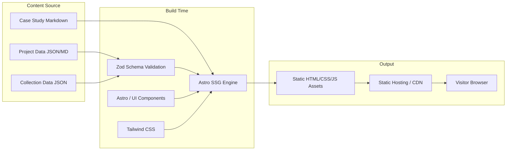

# My Portfolio Architecture

This document details the codebase structure and high-level architecture for **My Portfolio — Projects, Skills & Proof of Work**, including system design, technology choices, and key implementation patterns.

## System Overview

My Portfolio is a **bilingual, evidence-driven personal portfolio** built to showcase developer projects, technical skills, and practical proof of work across software development, UI/UX design, automation, and artificial intelligence.

Key capabilities:
- Fast load times and static site generation (SSG) with Astro
- Bilingual architecture (Arabic RTL and English LTR)
- Schema-validated file-based content management for projects, collections, and case studies
- Client-side search and filtering across projects, skills, and evidence types
- Dedicated public collections highlighting curated projects for specific audiences

## System Design

**Architecture Type**: Static Site Generation (SSG)
- No server runtime or database required
- Pre-rendered static pages at build time
- Repository content files (Markdown/JSON) act as the single source of truth
- Fast client-side interactions for search, filter, and theme/locale switching

## Architecture Diagrams



## Technology Choices

| Layer | Technology | Purpose |
|---|---|---|
| **Framework** | [Astro](https://astro.build) | Static site generation, islands architecture, fast builds |
| **Language** | TypeScript (strict mode) | Type-safe development across schemas and components |
| **Styling** | Tailwind CSS + Scoped Styles | Utility-first styling with RTL support and custom properties |
| **Content** | Astro Content Collections / Zod | Structured validation for projects, collections, and case studies |
| **Testing** | Vitest / Playwright | Unit, schema validation, component, and E2E testing |

### Why Astro?
- **Zero JS by default**: Ships clean HTML/CSS; client-side JavaScript is loaded only for interactive components (search, filter, theme/locale toggle).
- **Island Architecture**: Isolates client-side state without heavy SPA overhead.
- **Content Collections**: Built-in Zod schema validation protects against broken links, missing required metadata, or malformed entries.
- **Native i18n & RTL support**: Clean separation for `/en` and `/ar` routes with directional layout handling.

## Directory Structure

```
my-portfolio/
├── docs/                      # Product specifications and architectural requirements
├── .docs/                     # Technical standards, design tokens, and testing guidelines
├── public/                    # Static public assets (images, icons, fonts)
│   ├── images/projects/       # Project cover images and evidence screenshots
│   └── favicon.svg
├── src/
│   ├── components/            # Reusable Astro and interactive components
│   │   ├── common/            # Header, Footer, LocaleSwitcher, ThemeToggle
│   │   ├── project/           # ProjectCard, ProjectGrid, EvidenceList, SkillBadge
│   │   └── search/            # SearchBar, FilterBar
│   ├── content/               # File-based content collections
│   │   ├── config.ts          # Zod schema definitions
│   │   ├── projects/          # Structured project data
│   │   ├── collections/       # Curated project collections
│   │   └── case-studies/      # Detailed project case studies
│   ├── layouts/               # Page layouts
│   │   └── BaseLayout.astro   # Root layout supporting LTR/RTL, meta tags, theming
│   ├── lib/                   # Utilities and business logic
│   │   ├── content.ts         # Querying, filtering, sorting project data
│   │   ├── i18n.ts            # Translation dictionaries and route helpers
│   │   └── search.ts          # Search indexing and filter helpers
│   ├── pages/                 # Astro file-based routing
│   │   ├── [lang]/            # Bilingual routes (/en, /ar)
│   │   │   ├── index.astro    # Homepage
│   │   │   ├── projects/      # Catalogue & project detail pages
│   │   │   └── collections/   # Curated collection pages
│   │   └── index.astro        # Default route redirect
│   └── styles/                # Global CSS and Tailwind directives
│       └── globals.css
├── tests/
│   ├── unit/                  # Vitest unit & schema tests
│   └── e2e/                   # Playwright end-to-end tests
├── astro.config.mjs
├── tailwind.config.mjs
└── tsconfig.json
```

## Content Architecture & Validation

Projects and collections must follow strict schemas to ensure data integrity:

1. **Stable Identifiers**: Every project has an immutable slug (`id`) used for URL generation and cross-referencing.
2. **Bilingual Fields**: Titles, summaries, roles, and descriptions must provide both Arabic and English variants.
3. **Structured Evidence**: Explicit links to source code, live demos, test suites, or case studies.
4. **Referential Integrity**: Collections validate that all referenced project IDs actually exist at build time.

## Coding Standards & Conventions

- **Naming Conventions**: camelCase for variables/functions, PascalCase for components and schemas.
- **File Structure**: Colocation of unit tests and scoped styles alongside components.
- **Linting & Formatting**: ESLint + Prettier (see `.prettierrc`, `eslint.config.js`).
- **Path Aliases**: Consistent path aliases (e.g., `@/components`, `@/lib`, `@/content`) defined in `tsconfig.json`.

## Component Patterns

### Standard Astro Component Pattern
```astro
---
interface Props {
  title: string;
  lang: 'en' | 'ar';
  description?: string;
}

const { title, lang, description } = Astro.props;
const isRtl = lang === 'ar';
---

<section class="py-12" dir={isRtl ? 'rtl' : 'ltr'}>
  <h2 class="text-2xl font-bold tracking-tight text-foreground">{title}</h2>
  {description && <p class="mt-2 text-muted-foreground">{description}</p>}
  <slot />
</section>
```
