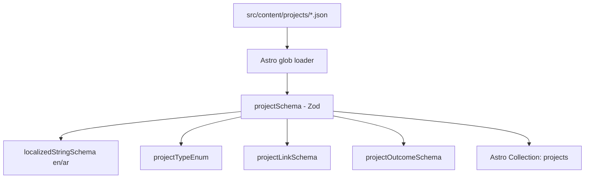

# Feature PB-004 - Define Project Content Schema

## User Story
*As a Portfolio Owner, I want a structured, validated project content schema in Astro Content Collections, so that my project records maintain consistent bilingual data, stable identifiers, accurate metadata, and fail early at build-time if corrupted.*

## Requirements
- **Core Functionality**:
  - Define `projectSchema` using Astro Content Collections and Zod in `src/content.config.ts`.
  - Enforce a stable unique identifier (`id`) formatted as lowercase kebab-case alphanumeric.
  - Require status (`"draft" | "published"`).
  - Require localized title and summary in both English and Arabic (`{ en: string, ar: string }`).
  - Support multiple project types (`types`) as a non-empty array of `("software" | "design" | "ui-ux" | "automation" | "ai" | "other")`.
  - Provide optional localized role/contribution (`role`).
  - Provide optional skills/technologies (`skills`) defaulting to empty array.
  - Provide optional validated date format (`date`: `YYYY`, `YYYY-MM`, or `YYYY-MM-DD`).
  - Provide optional cover image with localized alt text (`cover`).
  - Provide optional external evidence links with localized labels and categorized link types (`links`).
  - Provide optional documented outcomes/metrics (`outcomes`).
  - Export a `projects` content collection configured with the `glob` loader in `src/content.config.ts`.
- **Edge Cases**:
  - Missing Arabic or English fields in required localized blocks must throw descriptive validation errors.
  - Empty string or non-kebab identifiers must fail schema validation.
  - Empty `types` array or unlisted project types must fail validation.
  - Malformed URLs in external evidence links must fail validation.
  - Missing optional fields (cover, links, outcomes, role, date) must parse cleanly without runtime errors.
- **Constraints**:
  - Must use Astro 5 Content Collections API (`defineCollection` with loaders from `astro/loaders`).
  - Must not add third-party schema or UI libraries; use built-in Zod from `astro:content`.
  - No modification or regression to existing documentation files in `.docs/`, `docs/`, or `.agents/`.

## Open Questions
- None (All resolved during design: unified file model, JSON loader, strict MVP required fields).

## Acceptance Criteria
- [x] Each project has a stable unique identifier validated by schema.
- [x] Project titles and summaries follow the approved bilingual schema (`en` and `ar` required).
- [x] Project types support multiple values from the approved taxonomy.
- [x] Technologies and skills are represented consistently as a string array.
- [x] Optional sections (role, cover, date, links, outcomes) can be omitted when irrelevant.
- [x] External links have validated URLs, localized labels, and typed categories.
- [x] Dates conform to defined formats (`YYYY`, `YYYY-MM`, or `YYYY-MM-DD`).
- [x] Arabic and English content are represented according to the approved unified localization model.
- [x] Invalid content produces understandable, actionable validation errors.
- [x] Automated unit tests cover valid, minimal, and all invalid project content scenarios.

## Technical Details
- **Architecture**: Astro 5 Content Collections configured in `src/content.config.ts` using `glob({ pattern: '**/*.json', base: './src/content/projects' })`.
- **Dependencies**: Vitest for running unit tests (install `vitest` as devDependency if not present).
- **Files Affected**:
  - `src/content.config.ts`: Define and export schemas and the `projects` collection.
  - `src/content/projects/`: Sample/fixture project entries.
  - `tests/unit/content/project-schema.test.ts`: Comprehensive Zod unit tests.
  - `package.json`: Add test script (`pnpm test`) if needed for running vitest.

## Implementation Plan
- [x] Step 1 - Ensure Vitest is configured for unit testing schemas.
- [x] Step 2 - Create `src/content.config.ts` with `localizedStringSchema`, `projectTypeEnum`, `projectLinkSchema`, `projectOutcomeSchema`, and `projectSchema`.
- [x] Step 3 - Create unit test suite in `tests/unit/content/project-schema.test.ts` testing all acceptance criteria.
- [x] Step 4 - Add an example valid project entry in `src/content/projects/portfolio.json`.
- [x] Step 5 - Run `pnpm test`, `pnpm check`, and `pnpm build` to verify clean compilation and typecheck.

**Checkpoints**
- [x] Checkpoint 1: Unit tests pass for all positive and negative schema validation cases.
- [x] Checkpoint 2: `pnpm check` and `pnpm build` pass with the sample project in `src/content/projects/`.

## Implementation Workflow
*For each TODO above, the AI should:*
1. Show which files it plans to change.
2. Explain the approach.
3. Wait for approval.
4. Apply the change.
5. Run or update tests.

## Test Plan
- **Unit Tests**:
  - [ ] Test `projectSchema` with a complete valid project entry.
  - [ ] Test `projectSchema` with minimal valid project entry (omitting all optional fields).
  - [ ] Test `projectSchema` fails when `title.ar` or `title.en` is missing.
  - [ ] Test `projectSchema` fails when `summary.ar` or `summary.en` is missing.
  - [ ] Test `projectSchema` fails when `types` is empty or contains unknown types.
  - [ ] Test `projectSchema` fails on invalid ID formats (spaces, capital letters, underscores).
  - [ ] Test `projectSchema` fails on invalid link URLs.
  - [ ] Test `projectSchema` validates allowed date patterns (`YYYY`, `YYYY-MM`, `YYYY-MM-DD`) and rejects malformed ones.
- **Integration/Build**:
  - [ ] Verify `pnpm check` passes without TypeScript errors.
  - [ ] Verify `pnpm build` generates static output without errors.

## Design & Diagrams

## Decisions
- **Unified JSON Storage**: Keep translatable fields inside a single JSON entry per project to avoid syncing multiple separate files for common metadata.
- **Strict Locale Requirement on Core Fields**: `title` and `summary` require both `en` and `ar` to uphold the bilingual guarantee without runtime fallback bugs.
- **Permissive Optional Metadata**: Roles, cover images, metrics, and evidence links are strictly optional to respect the reality that not every project has public metrics or demos.
