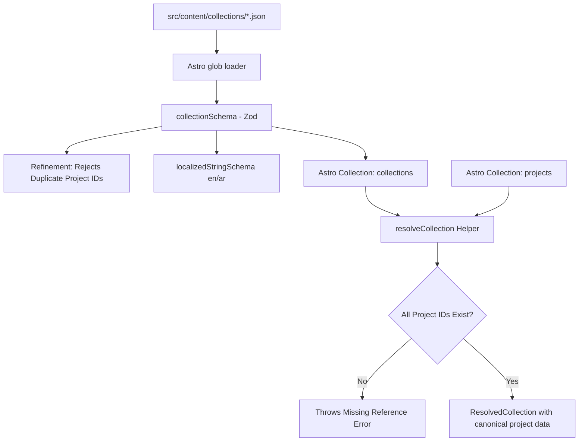

# Brainstorming Design: PB-005 - Define Collection Content Schema

**Status:** Approved
**Date:** 2026-10-25
**Priority:** P0

---

## 1. Problem Statement & Motivation
Public collections represent curated groupings of projects (such as "Featured Works", "Open Source Highlights", or "Design Systems"). We need a structured, type-safe content collection schema in Astro that:
1. Gives each collection a stable, unique identifier.
2. Manages membership via project IDs referencing canonical project entries.
3. Detects and prevents duplicate project IDs at the schema level.
4. Detects missing project references at resolution time.
5. Resolves full collection details directly from canonical project content.
6. Adheres to the unified bilingual localization model (`en` and `ar`).

---

## 2. Architecture & File Structure



### Proposed Files
- **`src/content/schemas/collection.ts`**: Defines Zod `collectionSchema` and exports types.
- **`src/content.config.ts`**: Registers the `collections` Astro content collection using `glob({ pattern: '**/*.json', base: './src/content/collections' })`.
- **`src/content/queries/collections.ts`**: Pure helper functions (`resolveCollection`, `validateCollections`) resolving and cross-referencing collections with canonical projects.
- **`src/content/collections/featured.json`**: Initial valid collection fixture.
- **`tests/unit/content/collection-schema.test.ts`**: Vitest suite for schema validation (valid cases, duplicates, invalid IDs, missing localization).
- **`tests/unit/content/collection-resolver.test.ts`**: Vitest suite for resolving collections and detecting missing references.

---

## 3. Schema Design

### `collectionSchema`
Reuses `localizedStringSchema` from `src/content/schemas/project.ts`:

```typescript
import { z } from 'astro/zod';
import { localizedStringSchema } from './project';

const idRegex = /^[a-z0-9]+(?:-[a-z0-9]+)*$/;

export const collectionSchema = z
  .object({
    id: z
      .string()
      .min(1)
      .regex(idRegex, 'ID must be kebab-case lowercase alphanumeric'),
    status: z.enum(['draft', 'published']),
    title: localizedStringSchema,
    summary: localizedStringSchema,
    projects: z
      .array(
        z.string().min(1).regex(idRegex, 'Project ID must be kebab-case lowercase alphanumeric')
      )
      .default([]),
    featured: z.boolean().default(false),
    order: z.number().int().optional(),
    cover: z
      .object({
        src: z.string().min(1),
        alt: localizedStringSchema,
      })
      .optional(),
  })
  .superRefine((data, ctx) => {
    const seen = new Set<string>();
    for (const pid of data.projects) {
      if (seen.has(pid)) {
        ctx.addIssue({
          code: z.ZodIssueCode.custom,
          message: `Duplicate project ID detected: "${pid}"`,
          path: ['projects'],
        });
      }
      seen.add(pid);
    }
  });

export type Collection = z.infer<typeof collectionSchema>;
```

---

## 4. Canonical Resolution & Reference Validation

```typescript
export interface ResolvedCollection<TProject> {
  id: string;
  data: Collection;
  projects: TProject[];
}

export function resolveCollection<TProject extends { id: string }>(
  collection: { id: string; data: Collection },
  availableProjects: TProject[]
): ResolvedCollection<TProject> {
  const projectMap = new Map<string, TProject>(
    availableProjects.map((p) => [p.id, p])
  );

  const resolvedProjects: TProject[] = [];
  for (const pid of collection.data.projects) {
    const project = projectMap.get(pid);
    if (!project) {
      throw new Error(
        `Collection "${collection.id}" references non-existent project ID "${pid}"`
      );
    }
    resolvedProjects.push(project);
  }

  return {
    id: collection.id,
    data: collection.data,
    projects: resolvedProjects,
  };
}
```

---

## 5. Error Handling & Validation Rules

1. **Duplicate Project IDs**: Rejects immediately at schema validation time with a custom Zod error message.
2. **Missing Canonical Project**: Rejects when resolving/querying with a descriptive error naming both collection ID and missing project ID.
3. **Invalid Identifier Format**: Non-kebab-case collection IDs or project IDs fail regex validation.
4. **Localization Requirement**: Title and summary must have non-empty strings for both `en` and `ar`.

---

## 6. Testing Strategy

1. **Unit Tests (`collection-schema.test.ts`)**:
   - Valid collection fixture passes parsing.
   - Minimal collection fixture (omitting optional `cover`, `order`, defaulting `projects: []`) passes.
   - Collection with duplicate project IDs fails validation.
   - Collection with invalid `id` or malformed project IDs fails validation.
   - Collection with missing `en` or `ar` strings fails validation.
2. **Unit Tests (`collection-resolver.test.ts`)**:
   - Resolves canonical projects in original sequence specified by collection.
   - Throws clear error when a project ID is not present in provided projects list.
3. **Build & Type Check**:
   - Ensure `pnpm test`, `pnpm check`, and `pnpm build` pass cleanly with fixture.
