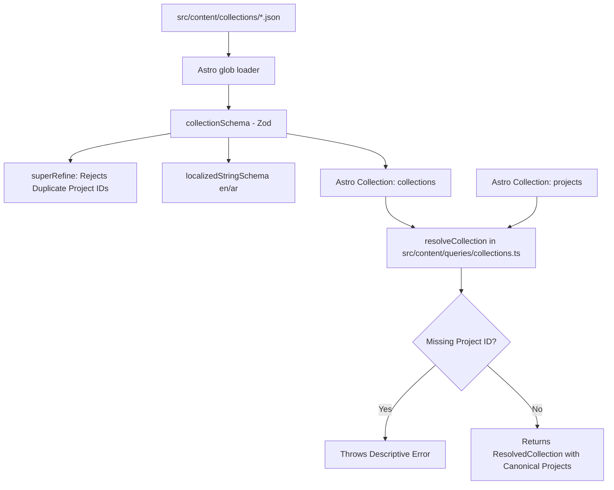

# Feature PB-005 - Define Collection Content Schema

## User Story
*As a Portfolio Owner, I want a structured, validated collection content schema and resolution mechanism in Astro Content Collections, so that curated project groupings maintain stable identifiers, bilingual metadata, guaranteed project references without duplicates, and resolve details directly from canonical project content.*

## Requirements
- **Core Functionality**:
  - Define `collectionSchema` using Astro Content Collections and Zod in `src/content/schemas/collection.ts`.
  - Enforce a stable unique identifier (`id`) formatted as lowercase kebab-case alphanumeric.
  - Require status (`"draft" | "published"`).
  - Require localized title and summary in both English and Arabic (`{ en: string, ar: string }`).
  - Represent project membership as an array of lowercase kebab-case project IDs (`projects`).
  - Detect and reject duplicate project IDs within a collection at schema validation time.
  - Support optional metadata: `featured` (boolean, default `false`), `order` (integer), and `cover` (`{ src: string, alt: localizedStringSchema }`).
  - Register and export a `collections` content collection configured with the `glob` loader in `src/content.config.ts`.
  - Provide a canonical resolution utility (`resolveCollection`) in `src/content/queries/collections.ts` that detects missing project references and hydrates collection entries with canonical project data in the specified order.
- **Edge Cases**:
  - Duplicate project IDs in a collection must fail schema validation with a clear error.
  - Referencing a non-existent project ID during resolution must throw a descriptive error specifying both the collection ID and the missing project ID.
  - Missing Arabic or English title/summary must throw descriptive validation errors.
  - Invalid ID formats (uppercase, spaces, special symbols) for collection ID or project IDs must fail schema validation.
  - Empty `projects` array is valid (representing an empty or draft collection).
- **Constraints**:
  - Must use Astro 5 Content Collections API (`defineCollection` with `glob` loader).
  - Must not introduce external UI libraries or third-party validation dependencies beyond Astro's built-in Zod.
  - Conform to existing code standards and test patterns.

## Open Questions
- None (All resolved during design: duplicate ID rejection rule, JSON file format, resolution helper architecture).

## Acceptance Criteria
- [x] Each collection has a stable unique identifier.
- [x] Collection membership references project IDs.
- [x] Missing project references are detected.
- [x] Duplicate project IDs are handled according to the approved rule (fail validation).
- [x] Collection metadata supports the approved language model (`en` and `ar`).
- [x] Collection details are resolved from canonical project content.
- [x] Automated unit tests cover collection schema validation and canonical resolution logic.

## Technical Details
- **Architecture**:
  - Astro 5 Content Collections configured in `src/content.config.ts` using `glob({ pattern: '**/*.json', base: './src/content/collections' })`.
  - Query utility in `src/content/queries/collections.ts` providing pure helper `resolveCollection` and batch resolver `resolveAllCollections`.
- **Dependencies**: None new (uses existing `astro/zod`, `astro:content`, and `vitest`).
- **Files Affected**:
  - `src/content/schemas/collection.ts`: Define and export `collectionSchema` and TypeScript types.
  - `src/content.config.ts`: Register `collections` collection and export collection schema.
  - `src/content/queries/collections.ts`: Resolver helpers for hydrating project references and validating missing IDs.
  - `src/content/collections/featured.json`: Sample valid collection fixture.
  - `tests/unit/content/collection-schema.test.ts`: Unit tests for `collectionSchema`.
  - `tests/unit/content/collection-resolver.test.ts`: Unit tests for `resolveCollection`.

## Implementation Plan
- [x] Step 1 - Create `src/content/schemas/collection.ts` defining `collectionSchema` with duplicate ID rejection and metadata fields.
- [x] Step 2 - Update `src/content.config.ts` to export `collectionSchema` and register the `collections` content collection using the `glob` loader.
- [x] Step 3 - Create `src/content/queries/collections.ts` with `resolveCollection` function and missing reference error reporting.
- [x] Step 4 - Create unit test suite in `tests/unit/content/collection-schema.test.ts` covering valid, minimal, duplicate IDs, and invalid fields.
- [x] Step 5 - Create unit test suite in `tests/unit/content/collection-resolver.test.ts` covering canonical project hydration and missing reference detection.
- [x] Step 6 - Create sample collection entry `src/content/collections/featured.json` referencing existing `portfolio` project.
- [x] Step 7 - Run `pnpm test`, `pnpm check`, and `pnpm build` to verify clean compilation, typecheck, and test passes.

**Checkpoints**
- [x] Checkpoint 1: Unit tests pass for both schema validation and canonical project resolution.
- [x] Checkpoint 2: `pnpm check` and `pnpm build` pass cleanly with real content collection entries.

## Implementation Workflow
*For each TODO above, the AI should:*
1. Show which files it plans to change.
2. Explain the approach.
3. Wait for approval.
4. Apply the change.
5. Run or update tests.

## Test Plan
- **Unit Tests**:
  - [ ] Test `collectionSchema` with complete valid collection data.
  - [ ] Test `collectionSchema` with minimal valid collection data (omitting optional cover, order).
  - [ ] Test `collectionSchema` fails when duplicate project IDs are present.
  - [ ] Test `collectionSchema` fails when title/summary missing either `en` or `ar`.
  - [ ] Test `collectionSchema` fails on invalid kebab-case collection ID or project IDs.
  - [ ] Test `resolveCollection` resolves canonical project details in exact order.
  - [ ] Test `resolveCollection` throws descriptive error when referencing a non-existent project ID.
- **Integration/Build**:
  - [ ] Verify `pnpm check` passes without TypeScript errors.
  - [ ] Verify `pnpm build` completes successfully.

## Design & Diagrams

## Decisions
- **Duplicate Project ID Rule**: Enforced strictly at schema parse time via Zod `superRefine` to catch authoring bugs immediately at build time.
- **Reference Resolution via Query Utility**: Pure helper function `resolveCollection` keeps schemas declarative and decouples file-loading mechanics, making it straightforward to test with mock fixtures and run in Astro pages/endpoints.
- **JSON Format**: Kept consistent with the `projects` collection format using Astro's `glob` loader.
