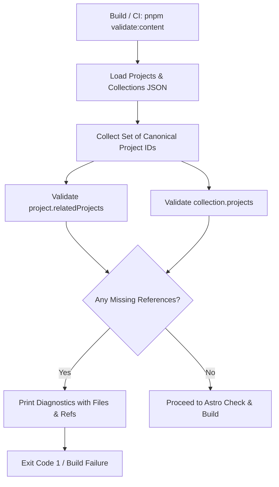

# Brainstorming Design: PB-006 - Validate Cross-Content References

**Status:** Approved
**Date:** 2026-10-25
**Priority:** P0

---

## 1. Problem Statement & Motivation
Projects can reference related projects via `relatedProjects`, and collections reference projects via `projects`. If an author references an ID that does not exist or references a project from itself, broken relationships occur silently unless caught.

We need a robust cross-content reference validation system that:
1. Enforces schema-level prevention of project self-references.
2. Validates that all referenced related-project IDs exist across canonical project content.
3. Validates that all collection-referenced project IDs exist.
4. Aggregates all invalid references and pinpoints the exact file and invalid identifier.
5. Integrates into the build and test pipeline to prevent publishing broken content.
6. Documents the error behavior for content authors.

---

## 2. Architecture & Workflow



---

## 3. Detailed Component Design

### 3.1 Project Schema Extension (`src/content/schemas/project.ts`)
Add `relatedProjects`:
```typescript
relatedProjects: z
  .array(
    z.string().min(1).regex(/^[a-z0-9]+(?:-[a-z0-9]+)*$/, 'Must be kebab-case lowercase')
  )
  .default([]),
```
Add `.superRefine()` check:
- Disallows duplicate IDs in `relatedProjects`.
- Disallows self-referencing (`data.relatedProjects.includes(data.id)`).

### 3.2 Cross-Reference Validator (`src/content/validation/cross-references.ts`)
Pure function:
```typescript
export interface ReferenceError {
  type: 'project' | 'collection';
  id: string;
  file: string;
  invalidRef: string;
  message: string;
}

export interface ValidationResult {
  valid: boolean;
  errors: ReferenceError[];
}

export function validateCrossReferences(input: {
  projects: Array<{ id: string; relatedProjects?: string[]; file?: string }>;
  collections: Array<{ id: string; projects?: string[]; file?: string }>;
}): ValidationResult
```

### 3.3 CLI / Script Runner (`scripts/validate-content.ts`)
- Scans `src/content/projects/*.json` and `src/content/collections/*.json`.
- Runs `validateCrossReferences`.
- If errors exist, outputs clear diagnostic table or lines with file path and missing ID, exiting with code 1.

### 3.4 Package.json Script Integration
- `"validate:content": "tsx scripts/validate-content.ts"`
- Update `"build": "pnpm validate:content && astro check && astro build"`

---

## 4. Documentation of Invalid Reference Behavior
Document in `.docs/STANDARDS.md` under Content Guidelines:
- Any broken reference in `relatedProjects` or collection `projects` fails content validation and blocks production build.
- Diagnostics explicitly display:
  - Affected content file path.
  - Source entity ID.
  - Invalid reference ID.

---

## 5. Testing Strategy
- **Unit Tests (`tests/unit/content/project-schema.test.ts`)**:
  - Validates `relatedProjects` accepts valid array of IDs.
  - Validates self-referencing throws schema error.
  - Validates duplicate IDs in `relatedProjects` throws schema error.
- **Unit Tests (`tests/unit/content/cross-references.test.ts`)**:
  - Passing scenario with valid interconnected projects and collections.
  - Failing scenario with missing project reference in `relatedProjects`.
  - Failing scenario with missing project reference in collection `projects`.
  - Aggregation test verifying all broken references are returned with correct `file` paths and `invalidRef`.
