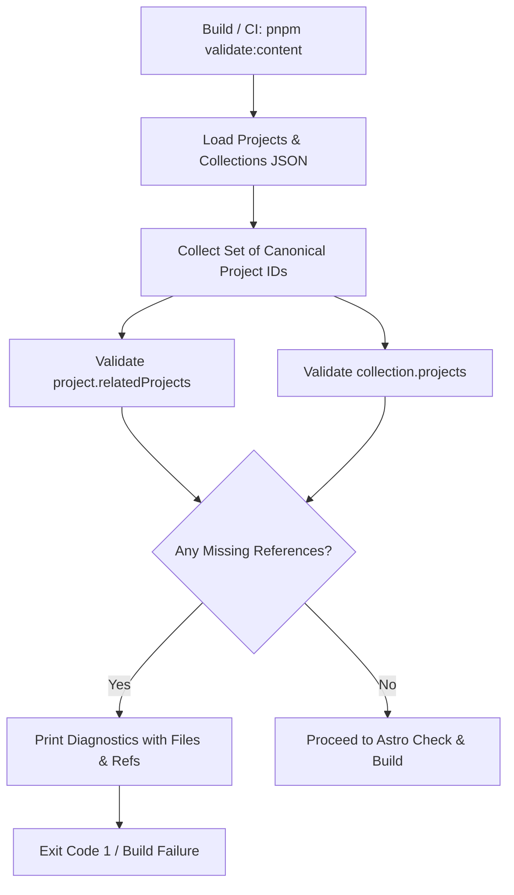

# Feature PB-006 - Validate Cross-Content References

## User Story
*As a Content Author and Developer, I want automated validation of cross-content references between projects and collections during testing and builds, so that broken related-project links, self-referencing projects, and dangling collection references are immediately detected with clear file and reference diagnostics.*

## Requirements
- **Core Functionality**:
  - Extend `projectSchema` in `src/content/schemas/project.ts` with optional `relatedProjects` array defaulting to `[]`.
  - Enforce schema validation rule preventing a project from referencing itself in `relatedProjects`.
  - Disallow duplicate project IDs within `relatedProjects` at schema parse time.
  - Create a pure cross-reference validation engine in `src/content/validation/cross-references.ts` (`validateCrossReferences`).
  - Detect missing `relatedProjects` references against canonical project IDs.
  - Detect missing collection `projects` references against canonical project IDs.
  - Aggregate all errors across all files and return detailed diagnostics identifying source entity type, source ID, affected file path, and offending invalid reference ID.
  - Create build-time runner `scripts/validate-content.ts` and package script `pnpm validate:content`.
  - Wire `validate:content` into the `pnpm build` pipeline to abort builds when references are broken.
  - Document invalid reference behavior and error format in `.docs/STANDARDS.md`.
- **Edge Cases**:
  - A project referencing itself must fail schema validation immediately.
  - Multiple broken references across multiple files must all be reported together before exiting.
  - Empty `relatedProjects` or empty collection `projects` must validate cleanly without error.
  - File paths in errors must accurately reflect `src/content/projects/<id>.json` or `src/content/collections/<id>.json`.
- **Constraints**:
  - Use existing toolchain (`tsx`, `vitest`, `astro`).
  - No external graph or database libraries.
  - Fail builds with non-zero exit code (1) when errors occur.

## Open Questions
- None (All resolved during design: aggregation behavior, self-referencing rule, build script integration).

## Acceptance Criteria
- [x] Related-project IDs must exist.
- [x] A project cannot reference itself as a related project.
- [x] Collection references must resolve to existing projects.
- [x] Errors identify the affected content file and invalid reference.
- [x] The behavior for invalid references is documented.
- [x] Automated unit tests cover cross-reference validation, self-reference prevention, and error aggregation.

## Technical Details
- **Architecture**:
  - Schema extension with Zod `superRefine` on `projectSchema`.
  - Pure validator in `src/content/validation/cross-references.ts`.
  - CLI runner in `scripts/validate-content.ts` integrated into `pnpm build`.
- **Dependencies**: None new (uses existing `astro/zod`, `vitest`, `tsx`).
- **Files Affected**:
  - `src/content/schemas/project.ts`: Add `relatedProjects` and self-reference check.
  - `src/content/validation/cross-references.ts`: Pure cross-reference validator.
  - `scripts/validate-content.ts`: CLI script for CI/build execution.
  - `package.json`: Add `validate:content` script and update `build`.
  - `.docs/STANDARDS.md`: Document cross-reference behavior and error reporting.
  - `tests/unit/content/project-schema.test.ts`: Add self-reference and relatedProjects tests.
  - `tests/unit/content/cross-references.test.ts`: Unit tests for cross-reference validation.

## Implementation Plan
- [x] Step 1 - Extend `projectSchema` in `src/content/schemas/project.ts` with `relatedProjects` and self-reference/duplicate validation.
- [x] Step 2 - Update `tests/unit/content/project-schema.test.ts` to test `relatedProjects`, self-referencing rejection, and duplicate rejection.
- [x] Step 3 - Create `src/content/validation/cross-references.ts` with pure `validateCrossReferences` function.
- [x] Step 4 - Create unit test suite `tests/unit/content/cross-references.test.ts` testing cross-reference success, missing related projects, missing collection projects, and error aggregation.
- [x] Step 5 - Create CLI script `scripts/validate-content.ts` and add `validate:content` to `package.json` and `pnpm build`.
- [x] Step 6 - Document invalid reference behavior and diagnostics in `.docs/STANDARDS.md`.
- [x] Step 7 - Run `pnpm test`, `pnpm validate:content`, `pnpm check`, and `pnpm build` to verify clean compilation and build pipeline.

**Checkpoints**
- [x] Checkpoint 1: Unit tests pass for `projectSchema` self-reference rules and `validateCrossReferences` diagnostics.
- [x] Checkpoint 2: `pnpm validate:content` and `pnpm build` pass cleanly with real content entries.

## Implementation Workflow
*For each TODO above, the AI should:*
1. Show which files it plans to change.
2. Explain the approach.
3. Wait for approval.
4. Apply the change.
5. Run or update tests.

## Test Plan
- **Unit Tests**:
  - [ ] Test `projectSchema` accepts valid `relatedProjects`.
  - [ ] Test `projectSchema` rejects self-reference in `relatedProjects`.
  - [ ] Test `projectSchema` rejects duplicate IDs in `relatedProjects`.
  - [ ] Test `validateCrossReferences` passes when all references are valid.
  - [ ] Test `validateCrossReferences` catches invalid related-project references with file and invalidRef.
  - [ ] Test `validateCrossReferences` catches invalid collection references with file and invalidRef.
  - [ ] Test `validateCrossReferences` aggregates multiple errors across multiple files.
- **Integration/Build**:
  - [ ] Run `pnpm validate:content` on real project/collection files.
  - [ ] Run `pnpm build` verifying `validate:content` is invoked.

## Design & Diagrams

## Decisions
- **Self-Reference Enforced in Schema**: Disallowing self-referencing at the Zod schema level catches authoring errors as early as single-file parsing.
- **Aggregated Diagnostic Reporting**: Rather than failing on the first error, `validateCrossReferences` collects all broken links across the entire repository to provide complete feedback in a single run.
- **Dedicated CLI Script**: `scripts/validate-content.ts` provides a lightweight, fast build step that can be run independently during local authoring or pre-commit hooks as well as in `pnpm build`.
