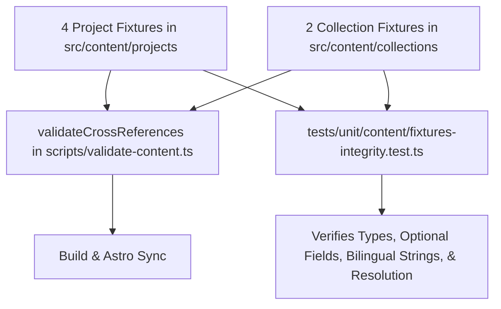

# Brainstorming Design: PB-007 - Prepare Representative Content Fixtures

**Status:** Approved
**Date:** 2026-10-25
**Priority:** P0

---

## 1. Problem Statement & Motivation
Developing the frontend catalogue, collection pages, language switcher, and project detail layouts requires realistic, structured bilingual content fixtures. These fixtures must:
1. Cover multiple project types (`software`, `design`, `ui-ux`, `automation`, `ai`).
2. Demonstrate multi-type projects.
3. Exercise all optional sections (`role`, `skills`, `date`, `cover`, `links`, `outcomes`, `relatedProjects`).
4. Demonstrate cross-project relationships (`relatedProjects`).
5. Demonstrate public collection resolution with multiple member projects.
6. Provide natural Arabic and English content for localization testing.
7. Maintain honesty by using realistic project scopes without fabricating professional claims.

---

## 2. Content Fixtures Specification

### 2.1 Project Fixtures (`src/content/projects/*.json`)

1. **`portfolio.json`**:
   - `id`: `"portfolio"`
   - `status`: `"published"`
   - `types`: `["software", "ui-ux"]`
   - `role`: Full-stack developer & designer
   - `skills`: `["Astro", "TypeScript", "Tailwind CSS", "Zod", "Vitest"]`
   - `date`: `"2026-10"`
   - `cover`: `/images/projects/portfolio-preview.webp`
   - `links`: Source repo, live demo
   - `outcomes`: 100/100 Lighthouse score
   - `relatedProjects`: `["design-system"]`

2. **`design-system.json`**:
   - `id`: `"design-system"`
   - `status`: `"published"`
   - `types`: `["design", "ui-ux"]`
   - `role`: UI/UX designer & token architect
   - `skills`: `["Figma", "Design Tokens", "CSS Architecture", "WCAG 2.2 AA"]`
   - `date`: `"2026-09"`
   - `cover`: `/images/projects/design-system-preview.webp`
   - `links`: Case study link, design spec repo
   - `outcomes`: Accessible color tokens with 4.5:1+ contrast across all modes
   - `relatedProjects`: `["portfolio"]`

3. **`cloud-etl-pipeline.json`**:
   - `id`: `"cloud-etl-pipeline"`
   - `status`: `"published"`
   - `types`: `["automation", "software"]`
   - `role`: Automation engineer
   - `skills`: `["Node.js", "TypeScript", "Docker", "JSON Schema"]`
   - `date`: `"2026-08"`
   - `links`: Pipeline repo
   - `outcomes`: Automated daily dataset synchronization
   - `relatedProjects`: `[]`

4. **`ai-summarizer.json`**:
   - `id`: `"ai-summarizer"`
   - `status`: `"published"`
   - `types`: `["ai", "software"]`
   - `role`: AI application developer
   - `skills`: `["TypeScript", "LLM APIs", "CLI Development"]`
   - `date`: `"2026-07"`
   - `links`: CLI tool repo
   - `outcomes`: Sub-second structured markdown summaries
   - `relatedProjects`: `["cloud-etl-pipeline"]`

### 2.2 Collection Fixtures (`src/content/collections/*.json`)

1. **`featured.json`**:
   - `id`: `"featured"`
   - `status`: `"published"`
   - `featured`: `true`
   - `order`: 1
   - `projects`: `["portfolio", "design-system", "ai-summarizer"]`

2. **`open-source.json`**:
   - `id`: `"open-source"`
   - `status`: `"published"`
   - `featured`: `false`
   - `order`: 2
   - `projects`: `["cloud-etl-pipeline", "ai-summarizer"]`

---

## 3. Architecture & Verification

---

## 4. Test Strategy
Create `tests/unit/content/fixtures-integrity.test.ts`:
- Loads actual fixture files from disk.
- Asserts all project fixtures parse via `projectSchema`.
- Asserts all collection fixtures parse via `collectionSchema`.
- Asserts that all project types (`software`, `design`, `ui-ux`, `automation`, `ai`) are represented.
- Asserts at least one project has multiple types.
- Asserts all optional fields are represented across the fixture set.
- Asserts `resolveCollection` resolves canonical projects for each collection in the specified order.
- Asserts Arabic and English titles/summaries are present and non-empty.
