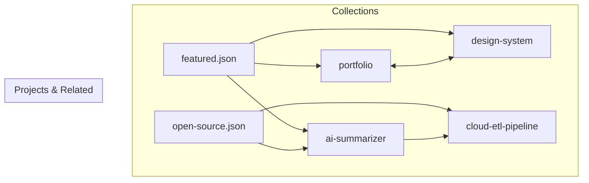

# Feature PB-007 - Prepare Representative Content Fixtures

## User Story
*As a Developer and Content Author, I want realistic, representative project and collection fixtures in Astro Content Collections, so that the UI catalogue, category filters, public collections, related-project links, and bilingual layouts can be actively developed and tested without fabricated claims.*

## Requirements
- **Core Functionality**:
  - Update `src/content/projects/portfolio.json` with `relatedProjects: ["design-system"]`.
  - Create `src/content/projects/design-system.json` covering `["design", "ui-ux"]` and referencing `["portfolio"]`.
  - Create `src/content/projects/cloud-etl-pipeline.json` covering `["automation", "software"]`.
  - Create `src/content/projects/ai-summarizer.json` covering `["ai", "software"]` and referencing `["cloud-etl-pipeline"]`.
  - Update `src/content/collections/featured.json` referencing `["portfolio", "design-system", "ai-summarizer"]`.
  - Create `src/content/collections/open-source.json` referencing `["cloud-etl-pipeline", "ai-summarizer"]`.
  - Ensure all project types (`software`, `design`, `ui-ux`, `automation`, `ai`) are represented across the fixture set.
  - Ensure multiple types are represented on at least one project.
  - Ensure optional sections (`role`, `skills`, `date`, `cover`, `links`, `outcomes`, `relatedProjects`) are exercised across the fixture set.
  - Provide natural English and Arabic translations for all text and label fields.
  - Maintain honesty and clarity in project descriptions, avoiding fabricated claims.
  - Create automated integration tests in `tests/unit/content/fixtures-integrity.test.ts` verifying the fixture set satisfies all requirements and acceptance criteria.
- **Edge Cases**:
  - All referenced IDs in `relatedProjects` and collection `projects` must resolve to existing canonical project IDs.
  - All project and collection entries must strictly satisfy `projectSchema` and `collectionSchema`.
- **Constraints**:
  - Adhere to established project schema patterns.
  - All fixture data must pass `pnpm validate:content`, `pnpm check`, and `pnpm build`.

## Open Questions
- None (All resolved during design: project list, scopes, and collection definitions).

## Acceptance Criteria
- [x] Multiple project types are represented.
- [x] At least one project has multiple types.
- [x] Optional content sections are represented.
- [x] Related projects can be demonstrated.
- [x] A public collection can be rendered.
- [x] Arabic and English content can be tested.
- [x] Placeholder content is clearly identified and does not imply fabricated professional achievements.
- [x] Automated tests verify the integrity and completeness of the fixture dataset.

## Technical Details
- **Architecture**: Astro 5 JSON content collections under `src/content/projects/` and `src/content/collections/`.
- **Dependencies**: None new (uses existing schema and validation tools).
- **Files Affected**:
  - `src/content/projects/portfolio.json`: Update with `relatedProjects`.
  - `src/content/projects/design-system.json`: New project fixture.
  - `src/content/projects/cloud-etl-pipeline.json`: New project fixture.
  - `src/content/projects/ai-summarizer.json`: New project fixture.
  - `src/content/collections/featured.json`: Update with multiple projects.
  - `src/content/collections/open-source.json`: New collection fixture.
  - `tests/unit/content/fixtures-integrity.test.ts`: Automated fixture integrity test suite.

## Implementation Plan
- [x] Step 1 - Update `src/content/projects/portfolio.json` with `relatedProjects: ["design-system"]`.
- [x] Step 2 - Create `src/content/projects/design-system.json` with `types: ["design", "ui-ux"]` and `relatedProjects: ["portfolio"]`.
- [x] Step 3 - Create `src/content/projects/cloud-etl-pipeline.json` with `types: ["automation", "software"]`.
- [x] Step 4 - Create `src/content/projects/ai-summarizer.json` with `types: ["ai", "software"]` and `relatedProjects: ["cloud-etl-pipeline"]`.
- [x] Step 5 - Update `src/content/collections/featured.json` and create `src/content/collections/open-source.json`.
- [x] Step 6 - Create unit test suite `tests/unit/content/fixtures-integrity.test.ts` verifying all acceptance criteria across the live fixture dataset.
- [x] Step 7 - Run `pnpm test`, `pnpm validate:content`, `pnpm check`, and `pnpm build` to verify clean build and schema validation.

**Checkpoints**
- [x] Checkpoint 1: Unit tests in `fixtures-integrity.test.ts` pass verifying type taxonomy coverage, multi-types, optional fields, and bilingual text.
- [x] Checkpoint 2: `pnpm validate:content`, `pnpm check`, and `pnpm build` succeed with 0 errors or warnings.

## Implementation Workflow
*For each TODO above, the AI should:*
1. Show which files it plans to change.
2. Explain the approach.
3. Wait for approval.
4. Apply the change.
5. Run or update tests.

## Test Plan
- **Unit Tests**:
  - [ ] Test each fixture file loads and successfully parses through `projectSchema` / `collectionSchema`.
  - [ ] Test that the taxonomy union of all project fixtures includes `software`, `design`, `ui-ux`, `automation`, `ai`.
  - [ ] Test that at least one project fixture has `types.length > 1`.
  - [ ] Test that optional sections (`role`, `skills`, `date`, `cover`, `links`, `outcomes`, `relatedProjects`) exist across the fixtures.
  - [ ] Test that `resolveCollection` succeeds for `featured` and `open-source` collections in exact sequence.
  - [ ] Test that all English and Arabic text fields are non-empty.
- **Integration/Build**:
  - [ ] `pnpm validate:content` succeeds with 4 projects and 2 collections.
  - [ ] `pnpm build` static output succeeds.

## Design & Diagrams

## Decisions
- **Realistic Sample Projects**: Using realistic, self-contained open-source and personal engineering projects provides relatable context for UI development without fabricating professional claims.
- **Symmetric Bidirectional Relatedness**: `portfolio` and `design-system` cross-reference each other to demonstrate circular navigation without infinite loops.
