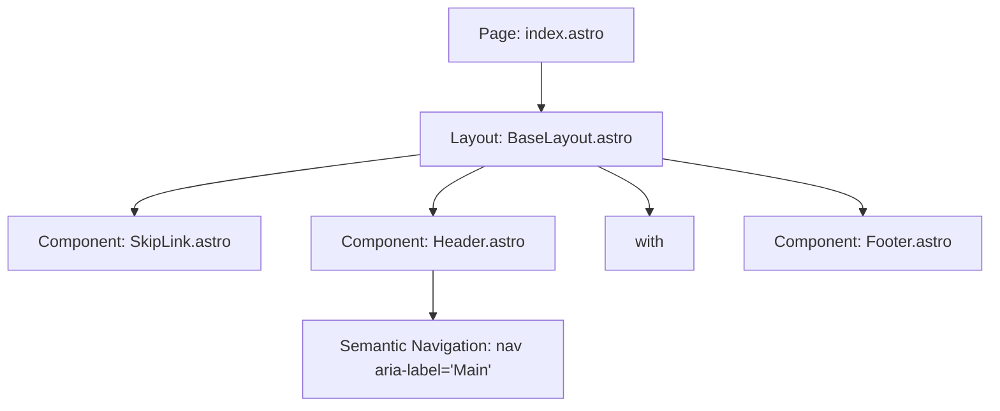

# PB-009: Implement Global Page Layout - Design

## 1. Problem Statement & Scope

A portfolio requires a structured, accessible, and responsive visual layout wrapping every page. In accordance with `.docs/ARCHITECTURE.md` and `.docs/DESIGN_SYSTEM.md`, the layout must embody Swiss-inspired minimalism, clean 1px dividing borders, accessible keyboard navigation, a responsive content container (max `1200px`), and natural support for both English (LTR) and Arabic (RTL).

### Key Goals
- Implement shared `<Header>`, `<Footer>`, and `<SkipLink>` components.
- Establish `src/layouts/BaseLayout.astro` as the central layout wrapper.
- Ensure consistent max width (`1200px`) and responsive gutters (`px-5 sm:px-10`).
- Provide an accessible skip-to-content link targeting the main content landmark (`#main-content`).
- Support bidirectional rendering (`lang="en" | "ar"`, `dir="ltr" | "rtl"`) utilizing logical Tailwind properties (`start-`, `end-`, `ms-`, `me-`).
- Refactor `src/pages/index.astro` to adopt `BaseLayout`.

---

## 2. Architecture & Component Decomposition

### Component Details
1. **`src/components/common/SkipLink.astro`**:
   - Anchors to `#main-content`.
   - Visually hidden until focused using `sr-only focus:not-sr-only`.
   - Fixed positioning using logical coordinates: `focus:fixed focus:top-4 focus:start-4 focus:z-50`.
   - High-contrast inverse colors: `bg-inverse-bg text-inverse-text ring-2 ring-focus rounded-md px-4 py-2 text-sm`.
2. **`src/components/common/Header.astro`**:
   - Sticky header with `backdrop-blur bg-bg/80 border-b border-border`.
   - Inner container constrained to `max-w-[1200px] mx-auto px-5 sm:px-10 py-4 flex items-center justify-between`.
   - Brand logo / home link with clear accessible name.
   - Semantic `<nav aria-label="Main navigation">` with keyboard-accessible focus rings (`focus-visible:ring-2 focus-visible:ring-focus`).
3. **`src/components/common/Footer.astro`**:
   - Bordered divider (`border-t border-border mt-auto bg-surface/50`).
   - Inner container (`max-w-[1200px] mx-auto px-5 sm:px-10 py-8 flex flex-col sm:flex-row items-center justify-between text-xs text-text-muted`).
   - Attribution, evidence statement, and copyright.
4. **`src/layouts/BaseLayout.astro`**:
   - Encapsulates `<html lang={lang} dir={resolvedDir} class="scroll-smooth">`.
   - Head metadata: charset, viewport, generator, title, description, favicon.
   - Imports `../styles/globals.css`.
   - Structural shell: `min-h-screen flex flex-col bg-bg text-text antialiased`.
   - Slots the main content inside `<main id="main-content" tabindex="-1" class="flex-1 w-full max-w-[1200px] mx-auto px-5 sm:px-10 py-8 md:py-16">`.

---

## 3. Bilingual & Directional Adaptation (RTL / LTR)

- The layout accepts `lang?: 'en' | 'ar'` and optional `dir?: 'ltr' | 'rtl'`.
- Default resolution logic:
  - If `dir` is provided explicitly, use it.
  - Otherwise, if `lang === 'ar'`, default `dir` to `'rtl'`.
  - Otherwise, default to `'ltr'`.
- Use logical CSS properties throughout layout components:
  - `start-4` instead of `left-4`
  - `ms-auto` instead of `ml-auto`
  - `space-x-` or flex `gap-` rather than directional margins.

---

## 4. Verification & Testing Strategy

- **Automated Tests (`tests/unit/layout/base-layout.test.ts`)**:
  - Test `SkipLink.astro` markup and attributes (`href="#main-content"`).
  - Test `Header.astro` semantic landmarks and navigation links.
  - Test `Footer.astro` markup and content.
  - Test `BaseLayout.astro` rendering:
    - Default `lang="en"` and `dir="ltr"`.
    - Auto-derivation of `dir="rtl"` when `lang="ar"`.
    - Presence of `#main-content` container with `max-w-[1200px]`.
- **Project Checks**:
  - `pnpm check`: Type check Astro components.
  - `pnpm lint` and `pnpm format`: Linting and formatting rules.
  - `pnpm test`: Execute vitest suite.
  - `pnpm build`: Verify clean static SSG build.
