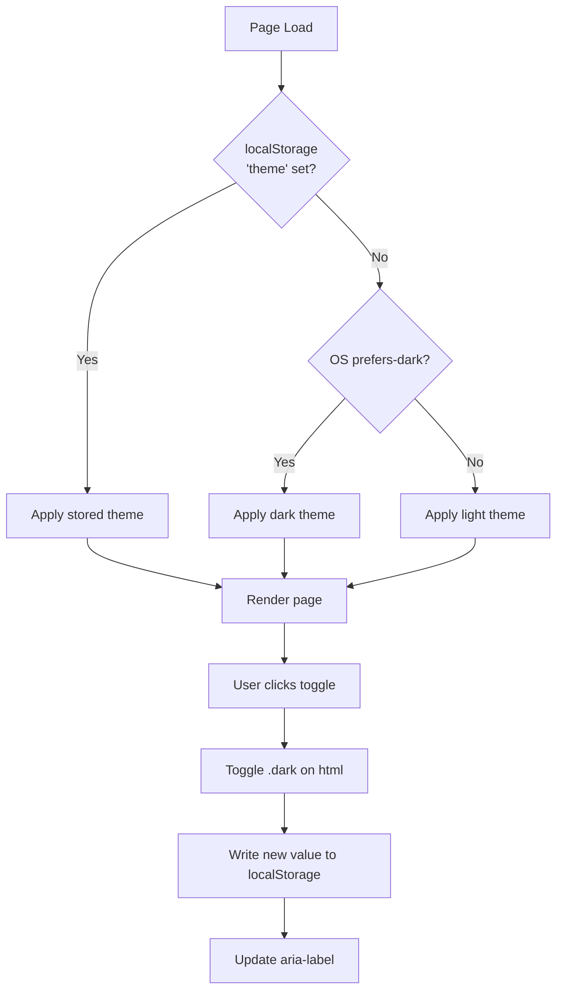

# Feature PB-021 - Implement Light and Dark Themes

## User Story
*As a visitor to the portfolio site, I want the site to respect my OS color-scheme preference on first visit and let me manually switch between light and dark themes, so that I can read content comfortably in any lighting condition.*

## Requirements

- **Core Functionality**
  - Detect OS `prefers-color-scheme` on first visit and apply the matching theme before the first paint.
  - Allow manual toggle between light and dark via a button in the Header nav bar.
  - Persist the user's manual choice in `localStorage` under the key `'theme'`; honour it on all subsequent page loads.
  - Apply the `.dark` class to `<html>` to activate dark-mode CSS tokens (already defined in `globals.css`).
  - Provide smooth color cross-fade (~150ms) when switching themes via a CSS `transition` on `html`.

- **Edge Cases**
  - No `localStorage` access (private browsing, blocked storage): fall back gracefully to OS preference on every load.
  - First visit with no stored preference: OS `prefers-color-scheme` determines initial theme.
  - JS disabled: site renders in light mode (`:root` default) without a toggle — acceptable degradation.

- **Constraints**
  - No external icon libraries; sun/moon SVGs are inline.
  - No external UI libraries; Tailwind CSS + Astro only.
  - Flash-prevention script must be `is:inline` and run synchronously before any paint.
  - CSS transition must affect **only** `color` and `background-color` — no layout properties.
  - `MediaQueryList` live listener is out of scope (YAGNI); OS changes after first visit do not override a stored preference.

## Open Questions
- None. All decisions resolved during design phase (see design doc).

## Acceptance Criteria
- [ ] Both themes use the approved monochrome design system tokens.
- [ ] Text and controls remain readable in each theme (contrast validated by existing tokens).
- [ ] Theme switching (via toggle button) visibly updates the interface without a hard flash.
- [ ] Theme choice is consistent across full-page navigations (SSG-safe persistence).
- [ ] Initial theme follows OS preference; subsequent visits honour `localStorage`.
- [ ] Theme transitions do not cause layout shifts.
- [ ] Toggle button is keyboard-accessible with a visible focus ring.
- [ ] `aria-label` on the toggle always announces the *next* action ("Switch to dark/light mode").

## Technical Details

- **File Layout**
  ```
  src/
    components/common/
      ThemeToggle.astro        ← new
      Header.astro             ← updated
    layouts/
      BaseLayout.astro         ← updated
    styles/
      globals.css              ← updated
  ```

- **Flash Prevention Script** — `<script is:inline>` injected in `BaseLayout.astro` `<head>`:
  ```js
  const stored = localStorage.getItem('theme');
  const prefersDark = window.matchMedia('(prefers-color-scheme: dark)').matches;
  const theme = stored ?? (prefersDark ? 'dark' : 'light');
  document.documentElement.classList.toggle('dark', theme === 'dark');
  ```

- **CSS Transition** — added to `globals.css` in `@layer base`:
  ```css
  html {
    transition: color 150ms ease, background-color 150ms ease;
  }
  ```

- **ThemeToggle client script** — ~10 lines; click handler toggles `.dark` on `document.documentElement`, writes to `localStorage`, updates `aria-label`.

- **Icon visibility** — driven purely by Tailwind `dark:block` / `dark:hidden` on the two SVG elements; no JS needed for icon swap.

- **Dependencies** — none new; uses existing Astro + Tailwind setup.

## Implementation Plan
- [x] **Step 1 – CSS transition**: Add `html { transition: color 150ms ease, background-color 150ms ease; }` to `globals.css` inside `@layer base`.
- [x] **Step 2 – Flash prevention**: Add `<script is:inline>` to `BaseLayout.astro` `<head>` that reads `localStorage` / `prefers-color-scheme` and applies `.dark` before paint.
- [x] **Step 3 – ThemeToggle component**: Create `src/components/common/ThemeToggle.astro` with the icon button (sun + moon inline SVGs, Tailwind visibility swap, client toggle script, accessible `aria-label`).
- [x] **Step 4 – Header integration**: Import and render `<ThemeToggle />` as the last item in the Header nav list.
- [x] **Step 5 – Tests**: Add `tests/unit/ui/ThemeToggle.test.ts` verifying: button element present, both SVG icons present, `aria-label` attribute exists, `dark:block` / `dark:hidden` classes present, `localStorage.setItem` call in script source.
- [x] **Step 6 – Manual verification**: Start dev server (`pnpm dev`), confirm: light/dark toggle works, no flash on reload, OS preference respected on first visit, theme persists across page navigation.

**Checkpoints**
- [ ] After Step 2: reload page in browser, confirm no flash of wrong theme.
- [ ] After Step 4: confirm toggle button appears in header on both mobile and desktop widths.
- [ ] After Step 5: `pnpm test` passes (all existing + new tests green).

## Implementation Workflow
*For each TODO above, the AI should:*
1. Show which files it plans to change.
2. Explain the approach.
3. Wait for approval.
4. Apply the change.
5. Run or update tests.

## Test Plan

- **Unit Tests**
  - [ ] `ThemeToggle` — button element is present in the markup.
  - [ ] `ThemeToggle` — both SVG icons are present (sun + moon).
  - [ ] `ThemeToggle` — button has an `aria-label` attribute.
  - [ ] `ThemeToggle` — sun icon has `dark:block` class; moon icon has `dark:hidden` class.
  - [ ] `BaseLayout` — `<head>` contains the flash-prevention inline script referencing `localStorage`.
  - [ ] `globals.css` — contains `transition:` rule on `html`.

- **Manual Verification**
  - [ ] UI Check: Toggle button visible in header; icon swaps on click; smooth color transition.
  - [ ] Persistence: Reload after toggle — theme is restored without flash.
  - [ ] First visit: Clear `localStorage`, reload — OS preference applied correctly.
  - [ ] Mobile Check: Toggle button accessible and tappable at small viewport widths.
  - [ ] Keyboard: Tab to button, press Enter/Space — theme switches, focus ring visible.

## Design & Diagrams



## Decisions

| Decision | Choice | Rationale |
|----------|--------|-----------|
| Initial theme | System `prefers-color-scheme` | Respects OS preference on first visit |
| Persistence | `localStorage` key `'theme'` | Explicit user choice always wins after first toggle |
| OS live re-listen | Not implemented | YAGNI — stored preference is sufficient |
| Toggle placement | Header nav bar | Always visible, low footprint |
| Toggle icon | Single icon (sun ↔ moon), inline SVG | No external library; common pattern |
| Transition style | CSS `color` + `background-color` ~150ms | Smooth with zero layout shift |
| JS-disabled fallback | Light mode (`:root` default) | Acceptable degradation for static portfolio |
