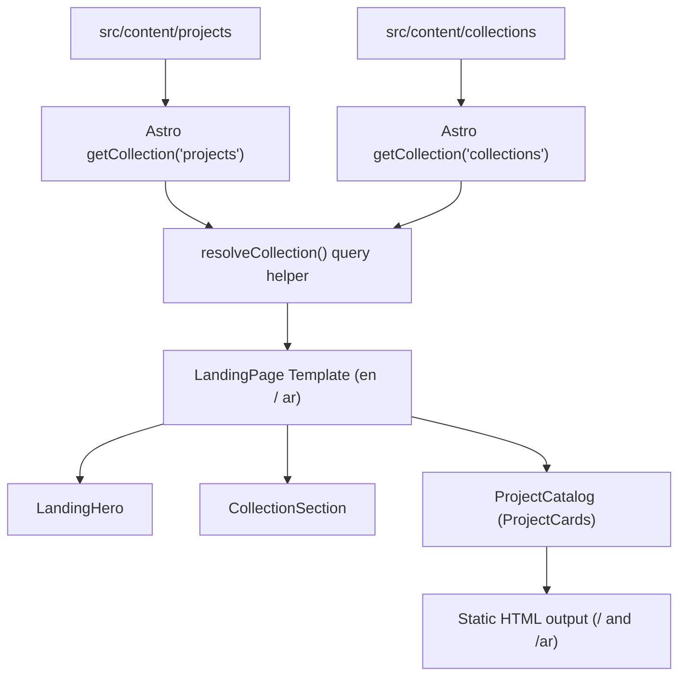

# Design Document: PB-011 Build the Portfolio Landing Page

## Overview
This document specifies the architectural design for the personal portfolio landing page (PB-011). The landing page communicates the portfolio's purpose ("Evidence-driven developer portfolio showcasing verified software development and AI engineering"), renders curated collections and project catalogues sourced from canonical Astro content collections, supports full English and Arabic (RTL) localization, and adheres to the monochrome design system tokens.

## Requirements & Acceptance Criteria
- [x] **Purpose Communication**: Clear hero statement conveying an evidence-driven, proof-of-work approach.
- [x] **Project Discovery**: Catalogue displaying canonical projects with metadata (skills, summaries, outcomes/metrics).
- [x] **Project Links**: Interactive links leading to dedicated detail views or repository/demo actions.
- [x] **Bilingual Support**: Pure SSG routing for English (`/`) and Arabic (`/ar`) with proper `dir="rtl"` layout.
- [x] **Responsive & Accessible**: Seamless rendering on mobile and desktop, strict WCAG AAA contrast, visible focus rings.
- [x] **Canonical Sourcing**: Dynamic query from Astro collections (`projects`, `collections`) without duplicate data.

## Architecture & Routes
```
src/
  pages/
    index.astro                 ← English landing page (lang="en", dir="ltr")
    ar/
      index.astro               ← Arabic landing page (lang="ar", dir="rtl")
  components/
    landing/
      LandingHero.astro         ← Purpose statement, proof-of-work metrics, CTAs
      CollectionSection.astro   ← Curated collections rendered with projects
      ProjectCatalog.astro      ← Responsive project grid catalogue
    ui/
      ProjectCard.astro         ← Updated to canonical project schema and design tokens
    common/
      Header.astro              ← Updated with language switcher (EN / AR)
```

## Data Flow


## Design Decisions

| Decision | Choice | Rationale |
|----------|--------|-----------|
| Routing for i18n | `/` (EN) and `/ar` (AR) | Zero-JS, SEO-friendly SSG routing consistent with static delivery. |
| Language switcher | Direct link toggle in Header (`/` ↔ `/ar`) | Fast, intuitive, works without JavaScript. |
| ProjectCard styling | Monochrome design tokens (`bg-surface`, `border-border`, `focus-visible:ring-focus`) | Replaces hardcoded Tailwind gray colors with the project's design system. |
| Content Fallback | `field[lang] ?? field['en']` | Prevents broken renders if an Arabic localization field is absent. |
| Project Link Fallback | `/projects/[id]` or external repo/demo | Ensures each project card provides direct navigation to evidence. |

## Testing Strategy
- Unit tests in `tests/unit/pages/landing-page.test.ts` and `tests/unit/ui/ProjectCard.test.ts`.
- Check language attributes, RTL direction, semantic structure, and design token classes.
- Static validation via `pnpm validate:content`, `pnpm check`, and `pnpm build`.
