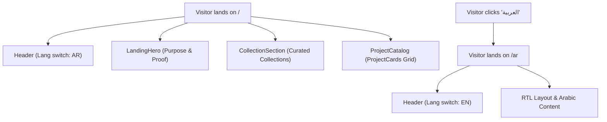

# Feature PB-011 - Build the Portfolio Landing Page

## User Story
*As a visitor to the portfolio, I want to view a landing page that clearly communicates the portfolio's purpose, highlights curated collections, and provides an accessible catalogue of projects in English or Arabic, so that I can explore verified proof of work and understand the developer's engineering capabilities.*

## Requirements

- **Core Functionality**
  - **Purpose Communication**: Landing hero section clearly communicating evidence-driven engineering, technical focus, and primary navigation targets.
  - **Curated Collections**: Display collections resolved via `resolveCollection()`, showcasing thematic groupings of projects.
  - **Project Catalogue**: Display all published projects from canonical collections in a responsive grid using `ProjectCard`.
  - **Bilingual & RTL**: Dedicated SSG routes for English (`/`) and Arabic (`/ar`) with full `dir="rtl"` support and an accessible language switcher link in the header.
  - **Project Links**: Project cards link to dedicated detail pages (`/projects/[id]`, `/ar/projects/[id]`) and provide links to external repositories/demos.
  - **Design System Tokens**: Fully styled using semantic monochrome tokens (`bg-surface`, `border-border`, `text-text`, `focus-visible:ring-focus`).

- **Edge Cases**
  - Empty or unpublished project states: Only published projects (`status: 'published'`) are rendered.
  - Missing field translations: Fall back to English text if an Arabic string is not populated (`field[lang] ?? field['en']`).
  - Missing cover image: Render accessible placeholder with project initials/title.

- **Constraints**
  - No external UI libraries; Tailwind CSS and Astro scoped components only.
  - Zero-JS static site generation (SSG) routing for language switching.
  - Full keyboard accessibility and WCAG AAA color contrast compliance.

## Open Questions
- None. All architectural decisions validated during design phase (see design doc).

## Acceptance Criteria
- [x] The landing page communicates the portfolio's purpose and evidence-driven focus.
- [x] Visitors can discover the project catalogue and curated collections.
- [x] Project links lead to the correct detail URLs or external repositories.
- [x] The layout fully supports both Arabic (`dir="rtl"`, `/ar`) and English (`dir="ltr"`, `/`).
- [x] The page works responsively on mobile and desktop viewports without layout shifts.
- [x] Content is dynamically sourced from canonical Astro project and collection collections.
- [x] All components follow the monochrome design system tokens and theme guidelines.

## Technical Details

- **File Layout**
  ```
  src/
    components/
      common/
        Header.astro                    ← updated (bilingual switcher)
      landing/
        LandingHero.astro               ← new
        CollectionSection.astro         ← new
        ProjectCatalog.astro            ← new
      ui/
        ProjectCard.astro               ← updated (canonical schema & design tokens)
    pages/
      index.astro                       ← updated (English landing page)
      ar/
        index.astro                     ← new (Arabic landing page)
  tests/
    unit/
      pages/
        landing-page.test.ts            ← new
      ui/
        ProjectCard.test.ts             ← updated
  ```

- **Data Fetching & Localization**
  - Uses `getCollection('projects', (p) => p.data.status === 'published')`.
  - Uses `getCollection('collections')` and `resolveCollection(col, projects)`.
  - Bilingual mapping helper provides localized title, summary, role, and tags based on current `lang`.

## Implementation Plan

- [x] **Step 1 – Design Token Alignment in ProjectCard**: Update `src/components/ui/ProjectCard.astro` to accept canonical `Project` data, use monochrome design tokens (`bg-surface`, `border-border`, `text-text`), and support localization (`lang`). Update existing `ProjectCard.test.ts`.
- [x] **Step 2 – Language Switcher in Header**: Update `src/components/common/Header.astro` to accept optional `lang` and `currentPath` props, rendering an accessible language switcher link (`العربية` / `English`).
- [x] **Step 3 – Landing Page Components**: Create `LandingHero.astro`, `CollectionSection.astro`, and `ProjectCatalog.astro` under `src/components/landing/`.
- [x] **Step 4 – English & Arabic Landing Pages**: Update `src/pages/index.astro` and create `src/pages/ar/index.astro` querying published content and rendering the landing components.
- [x] **Step 5 – Automated Tests**: Add `tests/unit/pages/landing-page.test.ts` verifying semantic structure, i18n attributes, content queries, and link behavior.
- [x] **Step 6 – Build & Verification**: Run `pnpm validate:content`, `pnpm test`, `pnpm check`, and `pnpm build` to confirm static site generation and zero type/lint errors.

**Checkpoints**
- [ ] After Step 1: `pnpm test` passes for `ProjectCard.test.ts`.
- [ ] After Step 3: Landing components pass type and template checks (`pnpm check`).
- [ ] After Step 5: All unit tests green (`pnpm test`).
- [ ] After Step 6: `pnpm build` generates `/index.html` and `/ar/index.html`.

## Implementation Workflow
*For each TODO above, the AI should:*
1. Show which files it plans to change.
2. Explain the approach.
3. Wait for approval.
4. Apply the change.
5. Run or update tests.

## Test Plan

- **Unit Tests**
  - `ProjectCard`: verifies rendering of localized title, summary, skills pills, outcome metrics, and design token classes.
  - `Header`: verifies presence of language switcher link toggling between `/` and `/ar`.
  - `LandingPage`: verifies query of published projects, resolution of collections, correct `lang` and `dir` on `BaseLayout`, and navigation anchor links.

- **Manual Verification**
  - UI Check: Purpose statement, curated collections, and project grid rendered with crisp monochrome aesthetics.
  - i18n Check: Navigate between `/` and `/ar`; verify text flips to Arabic with natural right-to-left layout alignment.
  - Theme Check: Toggle light/dark mode and confirm all landing page cards, buttons, and text maintain high contrast.
  - Responsive Check: Verify layout flows cleanly on mobile (<640px) and wide desktop screens.

## Design & Diagrams



## Decisions

| Decision | Choice | Rationale |
|----------|--------|-----------|
| Static i18n Strategy | Distinct `/` and `/ar` routes | Zero runtime overhead; standard SSG pattern; reliable SEO. |
| Design Tokens | Monochrome semantic tokens | Eliminates hardcoded utility colors; seamlessly supports dark/light mode. |
| Sourcing | Canonical Astro content collections | Avoids redundant content structures; enforces schema validation. |
| Fallback behavior | Default to English if Arabic string empty | Prevents missing copy or broken UI during partial localization. |
