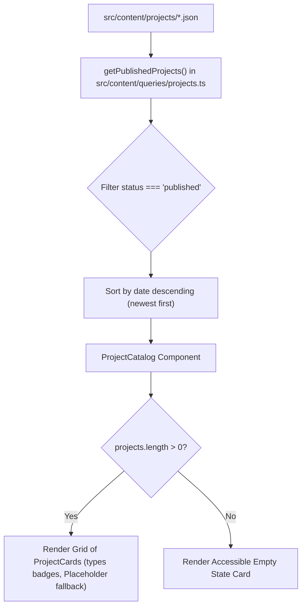

# Design Document: PB-012 Implement Project Listing

## Overview
This document specifies the architectural design for the project listing system (PB-012). It provides a canonical, chronologically ordered project catalogue rendered from content collection files. It introduces structured project type badges, elegant placeholder fallback for missing media, and an accessible empty state.

## Requirements & Acceptance Criteria
- [x] **Rendered from Content Files**: Directly queries canonical Astro `projects` content collection.
- [x] **Approved Summary Information**: Displays title, summary, date, skills pills, outcome metrics, and links.
- [x] **Multiple Project Types**: Visual representation of project types (`types: ['software', 'ai', ...]`) using bilingual pill badges.
- [x] **Resilient Media Layout**: Missing optional images use `Placeholder.astro` with identical aspect ratio (`16:9` / `h-48`) without breaking layout grids.
- [x] **Documented Ordering Rule**: Sorted in descending chronological order (newest date first).
- [x] **Defined Empty State**: Structured empty state card with bilingual messaging when project catalogue is empty.

## Architecture & Data Flow

```
src/
  content/
    queries/
      projects.ts              ← new query helper (getPublishedProjects, sortProjectsByDateDesc)
  components/
    ui/
      ProjectCard.astro        ← updated (types badges, Placeholder integration, formatted date)
    landing/
      ProjectCatalog.astro     ← updated (empty state support)
  pages/
    index.astro                ← uses getPublishedProjects()
    ar/
      index.astro              ← uses getPublishedProjects()
tests/
  unit/
    content/
      project-queries.test.ts  ← new unit tests for sorting & queries
    ui/
      ProjectCard.test.ts      ← updated tests for types & Placeholder
```



## Design Decisions

| Decision | Choice | Rationale |
|----------|--------|-----------|
| Ordering Rule | Chronological descending (newest date first) | Visitors expect recent work at the top. ISO date strings sort accurately. |
| Missing Image Handling | Integrated `Placeholder.astro` with aspect ratio matching cover image | Prevents layout shift or asymmetric card heights in responsive CSS grids. |
| Project Types Display | Discrete monochrome badges alongside date | Clearly signals project domain (AI, Software, Design) before reading summary. |
| Empty State Handling | Accessible bilingual empty-state card | Friendly, accessible, prevents blank section or broken UI when no projects are published. |

## Testing Strategy
- Unit test `sortProjectsByDateDesc()` with various ISO dates (`YYYY-MM-DD`, `YYYY-MM`, `YYYY`).
- Unit test `ProjectCard.astro` for type pills and `Placeholder` invocation.
- Unit test `ProjectCatalog.astro` for empty state rendering when passed `projects={[]}`.
- Full verification with `pnpm check`, `pnpm test`, and `pnpm build`.
