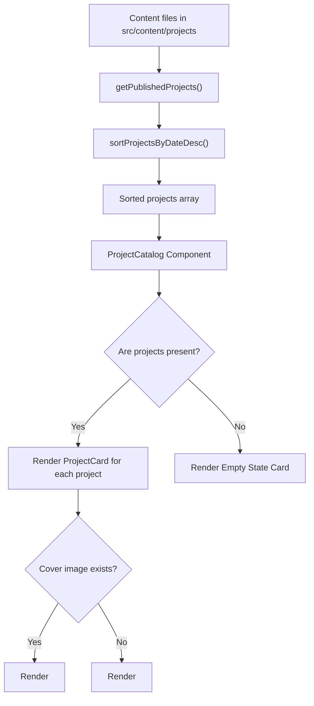

# Feature PB-012 - Implement Project Listing

## User Story
*As a visitor to the portfolio, I want to explore an organized, chronologically sorted catalogue of projects with clear indicators of project types, summaries, proof-of-work metrics, and reliable fallback handling when images are absent, so that I can easily discover and evaluate the developer's relevant work.*

## Requirements

- **Core Functionality**
  - **Rendered from Canonical Content**: Sourced dynamically from Astro's `projects` content collection.
  - **Ordering Rule**: Projects are sorted in descending chronological order (newest date first: `2026-10` before `2026-07`).
  - **Project Types Badges**: Visual indicator of project types (`types: ['software', 'ai', ...]`) on each card using bilingual labels.
  - **Media Resilience**: If a project omits a cover image, render the design system `Placeholder.astro` component with matching aspect ratio (`16:9` / `h-48`) without shifting or breaking grid alignment.
  - **Approved Summary Information**: Display localized title, summary, date, skills pills, outcome metrics, and links.
  - **Defined Empty State**: Display a structured, accessible empty state when no published projects are available.

- **Edge Cases**
  - Empty catalogue (`projects.length === 0`): Show empty state card with bilingual text and icon.
  - Incomplete dates: Handle `YYYY`, `YYYY-MM`, and `YYYY-MM-DD` gracefully in sorting and display.
  - Missing project image: Fall back cleanly to `Placeholder.astro`.
  - Multiple types: Render up to multiple type badges neatly wrapped.

- **Constraints**
  - No external UI libraries; Tailwind CSS and Astro scoped components only.
  - Monochrome design tokens (`bg-surface`, `border-border`, `text-text`, etc.).
  - Pure SSG; zero client-side JavaScript overhead.

## Open Questions
- None. All architectural decisions validated during design phase (see design doc).

## Acceptance Criteria
- [x] Projects are rendered from canonical content collection files.
- [x] Project cards display approved summary information (title, summary, skills, metrics, date, links).
- [x] Multiple project types are represented correctly with visual badges.
- [x] Missing optional images do not break the layout (renders `Placeholder.astro` with consistent dimensions).
- [x] Project ordering follows a documented rule (chronological descending).
- [x] Empty catalogue behavior is defined and rendered when project list is empty.

## Technical Details

- **File Layout**
  ```
  src/
    content/
      queries/
        projects.ts             ← new (query & sorting helper: getPublishedProjects, sortProjectsByDateDesc)
    components/
      ui/
        ProjectCard.astro       ← updated (types badges, Placeholder integration, formatted date)
      landing/
        ProjectCatalog.astro    ← updated (empty state support)
    pages/
      index.astro               ← updated (uses getPublishedProjects)
      ar/
        index.astro             ← updated (uses getPublishedProjects)
  tests/
    unit/
      content/
        project-queries.test.ts ← new
      ui/
        ProjectCard.test.ts     ← updated
      pages/
        landing-page.test.ts    ← updated
  ```

## Implementation Plan

- [x] **Step 1 – Project Queries & Sorting**: Create `src/content/queries/projects.ts` with `sortProjectsByDateDesc()` and `getPublishedProjects()`. Add unit tests in `tests/unit/content/project-queries.test.ts`.
- [x] **Step 2 – Enhanced ProjectCard Component**: Update `src/components/ui/ProjectCard.astro` to render project types badges, format dates, and invoke `Placeholder.astro` when `cover`/`image` is absent. Update `tests/unit/ui/ProjectCard.test.ts`.
- [x] **Step 3 – ProjectCatalog Empty State**: Update `src/components/landing/ProjectCatalog.astro` to render an accessible empty-state card when `projects.length === 0`.
- [x] **Step 4 – Page Integration**: Update `src/pages/index.astro` and `src/pages/ar/index.astro` to use `getPublishedProjects()`.
- [x] **Step 5 – Automated Tests & Verification**: Run test suite (`pnpm test`), Astro check (`pnpm check`), and project build (`pnpm build`).

**Checkpoints**
- [ ] After Step 1: `project-queries.test.ts` passes.
- [ ] After Step 2: `ProjectCard.test.ts` passes and renders `Placeholder`.
- [ ] After Step 3: `ProjectCatalog` renders empty state when passed `projects={[]}`.
- [ ] After Step 5: Full test suite green and build completes.

## Implementation Workflow
*For each TODO above, the AI should:*
1. Show which files it plans to change.
2. Explain the approach.
3. Wait for approval.
4. Apply the change.
5. Run or update tests.

## Test Plan

- **Unit Tests**
  - `project-queries.test.ts`: test date sorting descending with varied formats (`YYYY-MM-DD`, `YYYY-MM`, `YYYY`) and filtering unpublished drafts.
  - `ProjectCard.test.ts`: test type badges rendering, date rendering, and `Placeholder` invocation for missing media.
  - `landing-page.test.ts`: test empty state rendering in `ProjectCatalog`.

- **Manual Verification**
  - Catalog Grid Check: Inspect cards to confirm cover images or placeholders line up evenly.
  - Types Badge Check: Confirm types like `Software` and `AI` appear cleanly on cards in both English and Arabic.
  - Sorting Check: Verify newest projects appear at top of catalogue.

## Design & Diagrams



## Decisions

| Decision | Choice | Rationale |
|----------|--------|-----------|
| Ordering Strategy | Descending chronological date | Standard portfolio convention showing most recent work first. |
| Media Fallback | `Placeholder.astro` component | Guarantees identical height and aspect ratio; prevents grid reflow. |
| Type Badges | Discrete monochrome pills | Enhances discoverability of project domain at a glance. |
| Query Encapsulation | `src/content/queries/projects.ts` | Single source of truth for project querying and ordering logic. |
