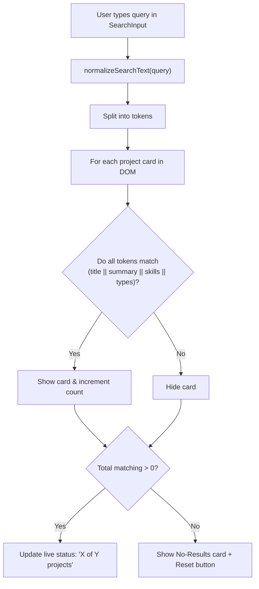

# Design Document: PB-013 Implement Project Search

## Overview
This document specifies the architectural design for project search (PB-013). Search operates entirely client-side without a backend, enabling visitors to filter the project catalogue instantaneously in English and Arabic. It normalizes bilingual input (including Arabic Alef, Taa Marbuta, and Tashkeel), searches across explicitly defined fields, provides accessible keyboard controls, and handles active, empty, and no-results states.

## Requirements & Acceptance Criteria
- [x] **Visible Results Update**: Typing instantly filters visible project cards and updates the result counter.
- [x] **Empty & No-Results States**:
  - Empty query displays all projects.
  - No-match query displays an accessible "No matching projects" state with a reset action.
- [x] **Bilingual Support (EN & AR)**:
  - Supports English and Arabic queries.
  - Normalizes Arabic Alef (`أ/إ/آ` -> `ا`), Taa Marbuta (`ة` -> `ه`), Yaa (`ى` -> `ي`), and strips Tashkeel/Tatweel.
- [x] **Backend-Free Architecture**: Operates statically on client-side DOM and embedded project metadata.
- [x] **Explicit Searchable Fields**:
  - `title`
  - `summary`
  - `skills`
  - `types` (and localized type labels)
- [x] **Keyboard Accessible**: Focus rings, `Escape` key clears search, standard `type="search"` controls, screen-reader live announcements.

## Architecture & Data Flow

```
src/
  utils/
    search.ts                  ← Bilingual normalization & multi-token matching logic
  components/
    ui/
      SearchInput.astro        ← Accessible search input with search icon and clear button
    landing/
      ProjectCatalog.astro     ← Integrates SearchInput, search script, live status, and no-results card
tests/
  unit/
    utils/
      search.test.ts           ← Unit tests for Arabic/English normalization and matching
    ui/
      SearchInput.test.ts      ← UI and accessibility tests for search controls
    pages/
      landing-page.test.ts     ← Integration verification in catalog
```



## Searchable Fields Specification

| Field | Source | Example (EN) | Example (AR) |
|---|---|---|---|
| `title` | `project.data.title[lang]` | `"AI Technical Summarizer"` | `"ملخص المستندات التقنية بالذكاء الاصطناعي"` |
| `summary` | `project.data.summary[lang]` | `"A terminal CLI tool..."` | `"أداة سطر أوامر..."` |
| `skills` | `project.data.skills[]` | `["TypeScript", "LLM APIs", "CLI Development"]` | Same tags + normalized |
| `types` | `project.data.types[]` + localized label | `software`, `ai` ("Software", "AI") | `software`, `ai` ("برمجيات", "ذكاء اصطناعي") |

## Normalization Rules

- **English**:
  - Lowercase, trim whitespace.
  - Unicode NFD normalization + strip diacritics (`[\u0300-\u036f]`).
- **Arabic**:
  - Strip Tashkeel (harakat): `[\u064B-\u065F\u0670]`.
  - Strip Tatweel (`ـ` / `\u0640`).
  - Normalize Alef variations: `[أإآٱ]` $\to$ `ا`.
  - Normalize Taa Marbuta: `ة` $\to$ `ه`.
  - Normalize Alef Maksura: `ى` $\to$ `ي`.

## Testing Strategy
- Unit tests in `tests/unit/utils/search.test.ts` for English and Arabic normalization cases.
- UI tests in `tests/unit/ui/SearchInput.test.ts` for accessibility attributes, clear button, and styles.
- Verification in `tests/unit/pages/landing-page.test.ts` for live status and no-results container.
- Full verification with `pnpm check`, `pnpm test`, and `pnpm build`.
