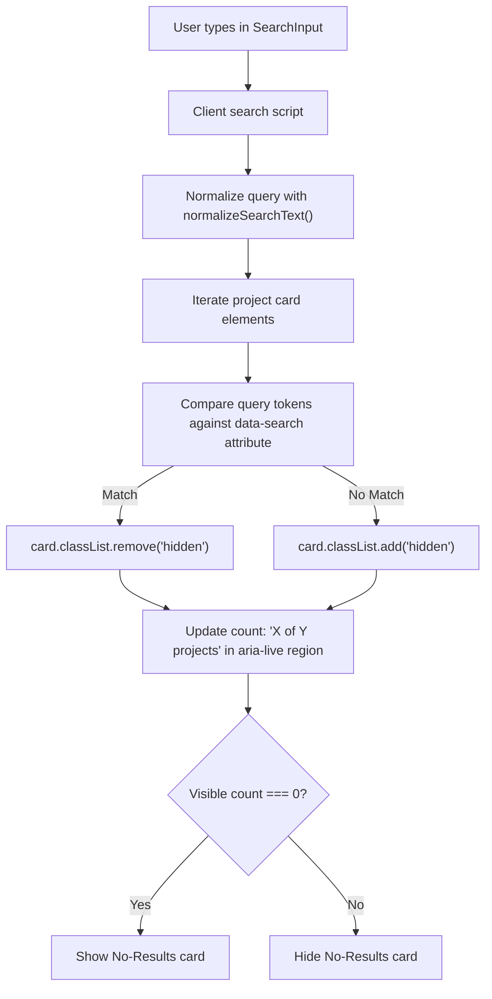

# Feature PB-013 - Implement Project Search

## User Story
*As a visitor to the portfolio, I want to search and filter projects using keywords in English or Arabic, so that I can quickly discover specific technologies, domain specializations, and evidence relevant to my interests without waiting for server responses.*

## Requirements

- **Core Functionality**
  - **Dynamic Results Update**: User input instantly filters the visible project cards and updates the result counter in real-time.
  - **Explicit Searchable Fields**: Search matches across project `title`, `summary`, `skills` (tags), and `types` (plus localized type names).
  - **Bilingual & Resilient Normalization**:
    - English: case-insensitive, trimmed, diacritic/accent-stripped.
    - Arabic: normalizes Alefs (`أ/إ/آ/ٱ` $\to$ `ا`), Taa Marbuta (`ة` $\to$ `ه`), Yaa (`ى` $\to$ `ي`), strips Tashkeel/harakat and Tatweel.
    - Multi-token search (AND across tokens, OR across fields).
  - **Zero-Backend Client Search**: Executes client-side against statically rendered project cards and embedded metadata.
  - **Empty and No-Results States**:
    - Empty query: displays all projects and total count.
    - No-match query: displays an accessible "No matching projects" card with a query reset action.
  - **Keyboard & Screen Reader Accessible**: Focus rings, `Escape` clears search, clear button (`✕`), `aria-live="polite"` status announcements.

- **Edge Cases**
  - Accidental extra spaces or punctuation: trimmed and normalized cleanly.
  - Partial token matching: matches substrings within words.
  - Special characters / regex injection characters: safely sanitized in search string.
  - Script disabled (JS-off): gracefully degrades to displaying the full project catalogue without breaking.

- **Constraints**
  - No external UI or heavy fuzzy search libraries.
  - Monochrome design system tokens (`bg-surface`, `border-border`, `focus-visible:ring-focus`).
  - Strict WCAG AAA color contrast compliance.

## Open Questions
- None. Searchable fields and bilingual normalization rules are fully resolved and documented.

## Acceptance Criteria
- [x] Search updates the visible project results instantly as the user types.
- [ ] Empty query and no-results states are explicitly handled and accessible.
- [x] Search works with supported Arabic and English text using normalized matching.
- [x] Search does not require a backend for the initial static catalogue.
- [x] The searchable fields are explicitly defined (`title`, `summary`, `skills`, `types`).
- [x] Search controls are keyboard accessible with focus indicators, `Escape` to clear, and clear button.

## Technical Details

- **File Layout**
  ```
  src/
    utils/
      search.ts               ← new (normalization & matching utility)
    components/
      ui/
        SearchInput.astro     ← new (accessible search input component)
      landing/
        ProjectCatalog.astro  ← updated (embeds search input, live region, no-results card, search script)
  tests/
    unit/
      utils/
        search.test.ts        ← new (normalization & matching tests)
      ui/
        SearchInput.test.ts   ← new (UI and accessibility tests)
      pages/
        landing-page.test.ts  ← updated
  ```

## Implementation Plan

- [x] **Step 1 – Bilingual Search Utilities**: Create `src/utils/search.ts` with `normalizeSearchText()`, `tokenizeQuery()`, and `matchesProject()`. Add unit tests in `tests/unit/utils/search.test.ts`.
- [x] **Step 2 – SearchInput UI Component**: Create `src/components/ui/SearchInput.astro` with search icon, clear button, ARIA attributes, and design tokens. Add unit tests in `tests/unit/ui/SearchInput.test.ts`.
- [x] **Step 3 – ProjectCatalog Integration**: Update `src/components/landing/ProjectCatalog.astro` to render `SearchInput`, attach data-search attributes to cards, include ARIA live status region, render no-results card, and wire up the client search controller.
- [x] **Step 4 – Tests & Verification**: Update `tests/unit/pages/landing-page.test.ts`, run `pnpm test`, `pnpm check`, and `pnpm build`.

**Checkpoints**
- [ ] After Step 1: `search.test.ts` passes (English + Arabic normalization and matching).
- [ ] After Step 2: `SearchInput.test.ts` passes.
- [ ] After Step 3: Astro check passes (`pnpm check`).
- [ ] After Step 4: Full test suite green and static build passes (`pnpm build`).

## Implementation Workflow
*For each TODO above, the AI should:*
1. Show which files it plans to change.
2. Explain the approach.
3. Wait for approval.
4. Apply the change.
5. Run or update tests.

## Test Plan

- **Unit Tests**
  - `search.test.ts`:
    - Normalizes English text with uppercase and accents (`TypeScript`, `Café`).
    - Normalizes Arabic text with Alef variants (`أداة`, `إدارة`, `آلة`).
    - Normalizes Taa Marbuta (`تقنية` $\to$ `تقنيه`) and Alef Maksura (`محتوى` $\to$ `محتوي`).
    - Strips Arabic Tashkeel (`مَشْرُوع`) and Tatweel (`مـــشروع`).
    - Matches multi-token query across title, summary, skills, and types.
    - Handles empty query and no-match query.
  - `SearchInput.test.ts`:
    - Renders `<input type="search">` with accessible `aria-label` and `role="search"`.
    - Renders search SVG icon and clear button.
    - Has focus ring classes matching design tokens.
  - `landing-page.test.ts`:
    - Verifies `ProjectCatalog` includes `SearchInput`, `role="status"`, `aria-live="polite"`, and no-results UI.

- **Manual Verification**
  - Typing in English ("summarizer", "AI", "TypeScript") narrows down to AI Technical Summarizer.
  - Typing in Arabic with or without hamza ("اداه", "أداة", "ذكاء") filters accurately.
  - Pressing `Escape` or clicking clear button (`✕`) clears input and restores all project cards.
  - Searching for nonsense string ("xyz999") shows the No Results state with "Reset search" button.

## Design & Diagrams



## Decisions

| Decision | Choice | Rationale |
|----------|--------|-----------|
| Architecture | Pure client-side DOM filtering | Zero backend dependency; 0ms latency; no external bundle dependencies. |
| Normalization | Unicode NFD + Arabic diacritic/alef mapping | Solves the most common mismatch issues in Arabic and English search. |
| Search Scope | `title`, `summary`, `skills`, `types` | Strikes the right balance between discoverability and precision. |
| Interaction | Live keystroke filtering with instant debounce | High-fidelity feedback without lag. |
