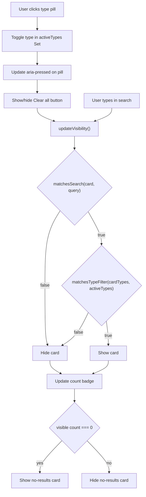

# Feature PB-014 - Implement Project Filters

## User Story
*As a portfolio visitor, I want to filter projects by type, so that I can quickly find projects relevant to my interests without scrolling through unrelated work.*

## Requirements

### Core Functionality
- A `FilterBar` component renders one toggle-pill button per project type (`software`, `design`, `ui-ux`, `automation`, `ai`, `other`)
- Clicking a pill toggles its active state; multiple pills can be active simultaneously
- Visibility logic: a project card is visible if it matches ANY active type (OR within category) AND matches the current search query (AND across filter+search)
- When no pills are active, all projects are visible (no filter applied)
- A "Clear all" button appears whenever at least one pill is active; clicking it deactivates all pills
- The result count badge and no-results empty state already in place (PB-013) continue to reflect the combined filter+search result

### Edge Cases
- A project with `types: []` or no `types` field: treated as matching no type — hidden when any filter is active
- All projects filtered out: existing no-results card (`id="no-search-results"`) is shown
- Filter + empty search: filter logic runs alone, search is effectively a no-op
- Search + no active filters: search runs alone, filter is effectively a no-op

### Constraints
- No external UI libraries — Tailwind CSS + Astro scoped styles only
- No URL params or server-side filtering — purely client-side DOM + vanilla JS
- Must be bilingual: type labels in EN and AR
- Must follow the existing `data-*` attribute + client script pattern established in PB-013

## Open Questions
*None — all decisions resolved in the design session.*

## Acceptance Criteria
- [x] Visitors can filter the project catalog by project type using toggle pills
- [x] Selecting multiple types shows projects matching ANY selected type (OR logic)
- [x] Active filter pills are visually distinct from inactive ones (`aria-pressed="true"`)
- [x] A "Clear all" button is visible when at least one filter is active and hidden otherwise
- [x] Clicking "Clear all" resets all pills to inactive and shows all projects
- [x] Filter and search work together: a project must satisfy both to be visible
- [x] Result count badge reflects the combined filter+search result count
- [x] No-results empty state is shown when combined filter+search yields zero cards
- [x] Filter labels are correctly localized in Arabic (`lang="ar"`)
- [x] All new utility functions have unit test coverage
- [x] All existing tests continue to pass; build succeeds with `pnpm build`

## Technical Details

### New Files
- `src/utils/filters.ts` — pure filter utility (no `astro:content` import)
- `src/components/ui/FilterBar.astro` — toggle-pill filter bar component
- `tests/unit/utils/filters.test.ts` — unit tests for filter utility
- `tests/unit/ui/FilterBar.test.ts` — render tests for FilterBar component

### Modified Files
- `src/components/landing/ProjectCatalog.astro` — integrate FilterBar, add `data-types` to cards, extend client script

### Algorithms
**`matchesTypeFilter(types: string[], activeTypes: Set<string>): boolean`**
```
if activeTypes.size === 0 → return true
return types.some(t => activeTypes.has(t))
```

**Combined visibility (extends existing search script):**
```
visible = matchesSearch(card, query) && matchesTypeFilter(cardTypes, activeTypes)
```

### Dependencies
- None (no new packages)

### API / DB / Schema Changes
- None

## Implementation Plan

- [x] **Step 1 — Filter utility** (`src/utils/filters.ts`)
  - Export `matchesTypeFilter(types: string[], activeTypes: Set<string>): boolean`
  - Export `ALL_PROJECT_TYPES` constant (ordered array of type slugs from schema)

- [x] **Step 2 — Unit tests for filter utility** (`tests/unit/utils/filters.test.ts`)
  - Test: empty `activeTypes` returns `true` for any card
  - Test: OR logic — partial overlap returns `true`
  - Test: no overlap returns `false`
  - Test: empty card `types` returns `false` when filter is active

- [x] **Step 3 — FilterBar component** (`src/components/ui/FilterBar.astro`)
  - Props: `types: string[]`, `lang?: 'en' | 'ar'`
  - Render one `<button data-filter-type="{slug}" aria-pressed="false">` per type
  - Bilingual `typeLabels` map (EN + AR)
  - Render `<button data-filter-clear>Clear all</button>` (hidden by default via `hidden` attribute)
  - Accessible: `role="group"`, `aria-label="Filter by type"`

- [x] **Step 4 — Unit tests for FilterBar** (`tests/unit/ui/FilterBar.test.ts`)
  - Test: renders one button per type slug
  - Test: each button has `data-filter-type` and `aria-pressed="false"`
  - Test: "Clear all" button is in the DOM
  - Test: Arabic labels rendered when `lang="ar"`

- [x] **Step 5 — ProjectCatalog integration** (`src/components/landing/ProjectCatalog.astro`)
  - Import and render `<FilterBar types={ALL_PROJECT_TYPES} lang={lang} />` above `<SearchInput />`
  - Add `data-types={JSON.stringify(project.data.types ?? [])}` to each card wrapper
  - Extend client `<script>`:
    - Query all `[data-filter-type]` pills and `[data-filter-clear]` button
    - Maintain `activeTypes: Set<string>` state
    - On pill click: toggle type in/out of `activeTypes`, update `aria-pressed`, show/hide "Clear all"
    - On "Clear all" click: clear `activeTypes`, reset all `aria-pressed` to `"false"`, hide button
    - Refactor `updateVisibility()` to apply both `matchesSearch` and `matchesTypeFilter`

- [x] **Step 6 — Update landing page tests** (`tests/unit/pages/landing-page.test.ts`)
  - Assert `FilterBar` is rendered inside `ProjectCatalog`
  - Assert project card wrappers have `data-types` attribute
  - Confirm all existing assertions still pass

**Checkpoints:**
- [x] After Step 2: `pnpm test` passes (filter utility tests green)
- [x] After Step 4: `pnpm test` passes (FilterBar render tests green)
- [x] After Step 6: `pnpm test` passes (all tests green) + `pnpm build` succeeds

## Implementation Workflow
*For each step above, the AI will:*
1. State which files it plans to change and the approach
2. Wait for approval
3. Apply the change
4. Run or update tests
5. Summarize files changed, behavior modified, and follow-up TODOs

## Test Plan

- **Unit Tests:**
  - [ ] `matchesTypeFilter` — empty active set returns true
  - [ ] `matchesTypeFilter` — OR logic with partial type overlap
  - [ ] `matchesTypeFilter` — no overlap returns false
  - [ ] `matchesTypeFilter` — empty card types returns false when filter active
  - [ ] `FilterBar` — renders one pill per type
  - [ ] `FilterBar` — pills have correct `data-filter-type` and `aria-pressed="false"`
  - [ ] `FilterBar` — "Clear all" button present
  - [ ] `FilterBar` — Arabic labels for `lang="ar"`

- **Integration:**
  - [ ] `landing-page.test.ts` — FilterBar present in ProjectCatalog
  - [ ] `landing-page.test.ts` — card wrappers have `data-types`
  - [ ] All existing 115 tests continue to pass

- **Manual Verification:**
  - [ ] UI check: pills toggle correctly, active state is visually distinct
  - [ ] UI check: "Clear all" appears/disappears correctly
  - [ ] UI check: combined filter+search narrows results correctly
  - [ ] UI check: empty state shown when no results match
  - [ ] Arabic page: labels in AR, RTL layout intact

## Design & Diagrams



## Decisions

| Decision | Choice | Rationale |
|---|---|---|
| Filterable fields | Types only | YAGNI; enum-controlled, skills are free-form |
| Within-category logic | OR (ANY) | Natural browsing; avoids zero-result traps |
| Filter + Search logic | AND | Predictable intersection; standard UX pattern |
| UI pattern | Toggle pills + Clear all | Self-documenting active state |
| Filter placement | Above search input | Filters are primary; search refines |
| State management | Client-side `Set<string>` | Consistent with existing search; no URL params needed |
| New utility file | `src/utils/filters.ts` | Pure functions; testable without `astro:content` |
