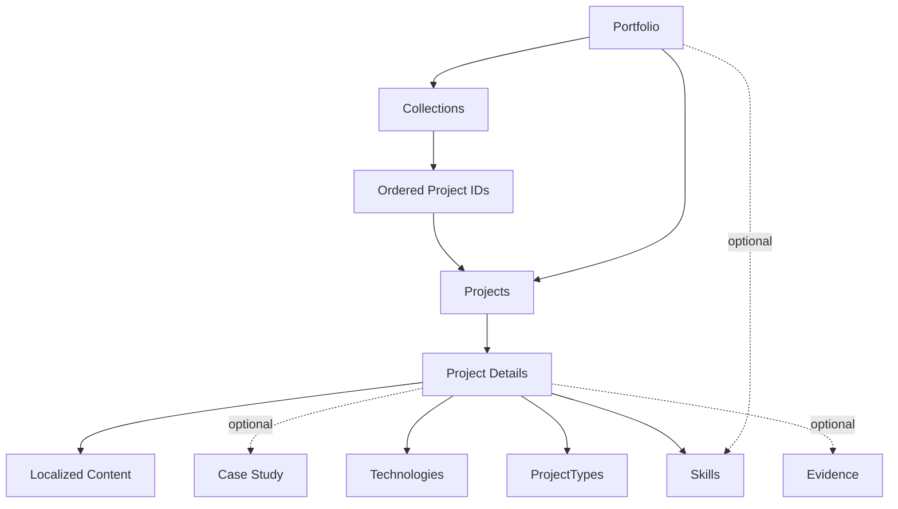

# Information Architecture — My Portfolio

## 1. Purpose

This document defines the information architecture (IA) of **My Portfolio — Projects, Skills & Proof of Work**.

It describes how portfolio content is organized, how users navigate between pages, how projects relate to skills and evidence, and how public collections and language switching behave.

The information architecture is designed to support:

- Discovering the developer and their work.
- Browsing projects by type, technology, skill, and evidence.
- Understanding individual projects and their technical details.
- Exploring related projects.
- Sharing curated collections with clients or recruiters.
- Switching between Arabic and English.
- Maintaining a simple, statically generated Astro architecture.

This document defines the logical structure, not the final visual layout or implementation details of every component.

---

## 2. IA Principles

### 2.1 Project-centered organization

Projects are the primary content entities. Skills, technologies, project types, case studies, and evidence help users understand and discover them.

### 2.2 Multiple paths to the same content

A project may be discovered through the main project listing, a search or filter, a related-project link, or a public collection.

These paths should resolve to the same canonical project page rather than creating duplicate pages for the same project.

### 2.3 Shallow, predictable navigation

The main navigation should remain compact. Users should be able to reach the project catalogue and understand how to access detailed project information without navigating through several intermediate pages.

### 2.4 Separate content from presentation

Project data, translated content, collection definitions, and page layouts should remain logically distinct.

A project should not need duplicated records simply because it appears in multiple collections or is related to another project.

### 2.5 Public by design

The portfolio and collection pages are public. Only information intentionally approved for publication should be included in the content source.

### 2.6 Language-aware, not language-dependent identity

Arabic and English are presentations of the same portfolio content. Language selection should not create a different project identity or a separate collection identity.

---

## 3. Top-Level Sitemap

The following is the proposed logical sitemap. Final URL patterns remain subject to confirmation.

```text
Portfolio
├── Home
├── Projects
│   ├── Project Listing
│   │   ├── Search
│   │   ├── Filter by Project Type
│   │   ├── Filter by Technology
│   │   ├── Filter by Skill
│   │   └── Filter by Evidence Type
│   └── Project Detail
│       ├── Overview
│       ├── Role and Contribution
│       ├── Technologies and Skills
│       ├── Technical Explanation
│       ├── Tests and Results
│       ├── External Links
│       ├── Case Study (when available)
│       └── Related Projects
├── Skills (proposed; confirmation required)
├── Public Collections
│   └── Collection Detail
│       ├── Collection Introduction
│       ├── Selected Projects
│       └── Link to Full Portfolio
└── Shared Global Elements
    ├── Main Navigation
    ├── Language Switch
    ├── Theme Switch
    └── Footer
```

### Sitemap notes

- A project detail page may omit sections for which no content exists.
- Case studies are optional and may be available in one or both languages.
- Public collections contain references to existing projects, not copies of project records.
- Search and filters are initially expected to operate within the project listing rather than requiring separate server-generated pages.
- A standalone Skills page is proposed but is not yet a confirmed requirement.

---

## 4. Global Navigation

### 4.1 Proposed primary navigation

| Item | Purpose | Status |
|---|---|---|
| Home | Introduce the developer and highlight selected work | Proposed |
| Projects | Browse the full project catalogue | Required |
| Skills | Explore professional capabilities | Proposed |
| About | Provide professional background and context | Open decision |
| Contact | Provide a way to initiate professional contact | Open decision |

The navigation should not be expanded merely to fill space. Every item must support a real user goal.

### 4.2 Utility controls

The following controls should be available globally where appropriate:

- **Language switch:** switch between Arabic and English.
- **Theme switch:** switch between light and dark themes.
- **Brand/home link:** return to the homepage.

The placement of utility controls in desktop and mobile layouts remains a visual design decision.

### 4.3 Footer

The footer may contain:

- A link to the full project catalogue.
- Relevant professional or contact links, if approved.
- A language switch or theme switch if not conveniently available elsewhere.
- A concise ownership or copyright notice.

Exact footer content is not yet finalized.

---

## 5. Page Definitions

### 5.1 Home

**Purpose:** establish the developer's professional identity and direct visitors toward relevant work.

Proposed content hierarchy:

1. Name or professional identity and concise introduction.
2. Primary professional focus or capabilities.
3. Selected projects.
4. A path to browse all projects.
5. Optional skills, evidence, or contact sections.

The homepage should not attempt to reproduce every detail available on project pages.

**Primary user actions:**

- Browse projects.
- Open a featured project.
- Explore skills, if the Skills page is approved.
- Open a public collection link received from another person.
- Switch language or theme.

### 5.2 Projects listing

**Purpose:** allow visitors to discover and compare projects.

Core content:

- Page title and concise introduction.
- Search field.
- Filter controls.
- Project result count or equivalent feedback.
- Project cards.
- Empty and no-results states.

Each project card should prioritize:

- Project title.
- Short summary.
- Project type or types.
- Selected technologies or skills.
- A link to the project detail page.

Additional metadata should only appear when it improves discovery.

**Search and filtering:**

- Search should support the agreed searchable project fields.
- Projects may belong to multiple project types.
- Filters should combine predictably.
- The initial implementation is expected to be client-side.
- Whether multiple selections within a single filter group use OR or AND semantics remains undecided.
- Whether evidence types appear as a visible filter remains to be confirmed.

The listing should not create separate canonical project pages for every filter combination.

### 5.3 Project detail

**Purpose:** explain what the project is, what the developer contributed, how it was built, and what evidence supports its value.

Proposed content hierarchy:

1. Project title and summary.
2. Project type and relevant metadata.
3. Role and contribution.
4. Skills and technologies.
5. Project overview and problem context.
6. Technical explanation.
7. Tests, outcomes, or other available evidence.
8. Relevant external links.
9. Case study, when available.
10. Related projects.

The exact order may vary according to the project's content, but the page should maintain a consistent information hierarchy.

#### Optional content

Not every project needs:

- A client rating.
- A demo.
- A public repository.
- A formal case study.
- Measurable results.
- Automated test evidence.

Missing content should be omitted rather than represented by empty sections or misleading placeholders.

#### External destinations

GitHub, demos, and other external resources should be clearly labeled and should not be confused with internal portfolio navigation.

### 5.4 Case study

**Purpose:** provide a deeper narrative about a project's context, decisions, implementation, and outcomes.

A case study may include:

- Context and problem.
- Objectives and constraints.
- The developer's role.
- Design and technical decisions.
- Implementation approach.
- Testing and validation.
- Results, limitations, and lessons learned.

Case studies are optional.

**Proposed content organization:** keep case-study prose separate from the core project metadata, with localized content where translations exist.

The final URL structure, exact content schema, and language fallback behavior remain undecided.

### 5.5 Public collection

**Purpose:** present a curated selection of projects relevant to a particular client, job opportunity, or professional discussion.

A collection consists of:

- A public share identifier or slug.
- Optional title and introductory description.
- An ordered list of project IDs.
- A link to the full portfolio.

The collection should resolve each project ID against the original project data. It must not duplicate project details into the collection definition.

#### Collection behavior

- Collections are public.
- Collection membership is explicitly configured.
- A project may appear in more than one collection.
- A project may have multiple project types independently of its collection membership.
- The displayed project details reflect the latest successfully built and deployed content.
- Collections do not update at runtime independently of the static deployment.
- Invalid project references should be detected during validation or the build process.

Whether a collection with an invalid project reference should fail the entire build or produce a controlled validation error is still an implementation decision.

### 5.6 Skills page — proposed

**Purpose:** provide a consolidated view of professional skills and their relationship to projects.

If approved, a skill page or section should help visitors understand capabilities through evidence, not just a list of keywords.

Potential structure:

- Skill or capability group.
- Relevant technologies or methods.
- Projects demonstrating the skill.
- Links to those projects.

The following are not yet decided:

- Whether skills have their own dedicated pages.
- Whether the Skills page is a standalone route or a homepage section.
- Whether skill categories are manually maintained.
- Whether technologies and broader skills are modeled as separate concepts.

The initial architecture should avoid creating a large taxonomy before the actual project catalogue requires one.

---

## 6. Content Model and Relationships

The information architecture distinguishes between content entities and the pages that present them.

### 6.1 Core entities

| Entity | Responsibility |
|---|---|
| Project | Primary record for a piece of work |
| Localized project content | Language-specific text for a project |
| Case study | Detailed project narrative |
| Skill | Capability associated with projects |
| Technology | Tool, framework, language, or platform |
| Project type | Classification of work |
| Evidence type | Category of supporting proof |
| Collection | Curated selection of project IDs |

These are logical entities. They do not imply that each entity must have its own page or separate storage system.

### 6.2 Relationship diagram



### 6.3 Relationship rules

- One project may have multiple types.
- One project may use multiple technologies.
- One project may demonstrate multiple skills.
- A skill or technology may be associated with multiple projects.
- A project may have a case study in one or both supported languages.
- A collection references projects by stable IDs.
- Related-project references use project IDs rather than copied project data.
- Related-project relationships are directional by default.
- Project metadata is resolved from the original project source at build time.

Whether skills, technologies, project types, and evidence categories become independently managed content collections depends on the final schema design.

---

## 7. Related Projects and Discovery

Related projects provide a secondary navigation path from one project to another.

### Initial behavior

- Related projects are manually configured by project IDs.
- The relationship is directional unless both projects explicitly reference each other.
- Related project details are resolved from the original project record.
- Self-references and unknown project IDs should be rejected by validation.
- A project with no configured related projects should omit the section.

Automatic recommendations based on shared technologies or skills are out of scope for the initial version.

The interface should not imply that a relationship is automatically reciprocal.

---

## 8. Bilingual Information Architecture

The portfolio supports Arabic and English.

### 8.1 Language selection

The initial language should be selected based on browser language preferences, with a manual language switch available.

The language-neutral identity of a project or collection must remain stable when the displayed language changes.

### 8.2 Language-aware navigation

- Navigation labels must be localized.
- Page titles and metadata should use the selected language where translations exist.
- The document language and text direction must match the active language.
- Arabic pages use RTL direction; English pages use LTR direction.
- Switching languages should preserve the current content destination where a corresponding translation exists.

### 8.3 Translation fallback

The exact translation policy remains unresolved.

Recommended initial policy:

- Project titles, summaries, and core display fields should be supplied in Arabic and English.
- Case-study translations may be optional in the first release.
- If a case study is available only in the other language, the interface should clearly indicate the available language rather than silently presenting untranslated text as if it were localized.
- A missing translation should never result in a broken internal link.

The owner must confirm this policy before the content schemas and language-routing behavior are finalized.

### 8.4 Language preference persistence

It remains undecided whether a manually selected language should persist across visits and how it should interact with browser language preferences.

Recommended behavior:

1. Respect an explicit saved user choice, if persistence is implemented.
2. Otherwise select a language from the browser preference.
3. Fall back to the default language when no supported preference is available.

The URL strategy for language-specific pages remains open.

---

## 9. Theme and Information Architecture

The site supports light and dark themes.

Theme selection changes the visual presentation, not the information hierarchy or content identity.

Requirements:

- The same navigation and content destinations must exist in both themes.
- Theme changes must not reset project filters or change the current project.
- Theme controls should remain accessible across the principal page types.
- Public collection pages must support both themes.
- The initial theme and preference persistence follow the design-system decisions, with implementation details still to be finalized.

---

## 10. URL and Routing Considerations

The URL structure has not been finalized. The routes below are conceptual examples only.

| Page | Conceptual route |
|---|---|
| Home | `/` |
| Projects listing | `/projects/` |
| Project detail | `/projects/{project-slug}/` |
| Case study | `/projects/{project-slug}/case-study/` or an equivalent structure |
| Skills | `/skills/` |
| Public collection | `/share/{collection-slug}/` |

These examples are not approved final routes.

### Routing requirements

- Project URLs should be stable and readable.
- Collection URLs should be public and easy to share.
- Query parameters may represent temporary search or filter state, if needed.
- Filter combinations should not automatically generate indexable duplicate pages.
- Language routing must be consistent with the final i18n strategy.
- Internal links must resolve to valid routes at build time.
- Missing projects, collections, or case studies should have deliberate fallback behavior.

The final decision should account for Astro's routing model, static generation, SEO, bilingual URLs, and the need for language-neutral collection links.

---

## 11. Error and Empty States

The information architecture should account for the absence of content as well as its presence.

### Projects listing

- No projects match the current filters.
- Search returns no results.
- No projects are available in a requested category.

Provide a clear message and a way to reset filters or broaden the search.

### Project detail

- Unknown project slug.
- Optional content unavailable.
- Translation unavailable.

A missing optional section should normally be omitted. A missing project should resolve to a proper not-found page.

### Public collection

- Unknown collection slug.
- Empty collection.
- Project reference invalid at build time.
- A collection references content that is not available in the selected language.

The build should validate project references. The user-facing response for each failure case should be determined during implementation.

### Case study

- Case study does not exist.
- Case study is available in only one language.
- Case study route is invalid.

Do not create links to case studies unless the target exists.

---

## 12. Search, SEO, and Discoverability

### Search and filtering

Search and filters are navigation aids within the project catalogue. They should not replace canonical project pages.

Searchable fields and filter behavior must be consistent with the project schema.

The exact treatment of evidence types, multi-select semantics, and URL synchronization remains undecided.

### SEO

- Each indexable page should have a meaningful title and description.
- Project pages should use stable canonical URLs.
- Arabic and English pages should expose the correct language metadata.
- Language alternatives should be linked appropriately once the URL structure is finalized.
- Public collections should have clear titles and descriptions when provided.
- Filter states should not produce uncontrolled indexable duplicates.
- Missing translations must not generate misleading language-alternate metadata.
- Internal links should use meaningful labels rather than generic text.

Search-engine indexing behavior for public collections remains a decision to make. Public availability does not automatically determine whether every collection should be indexed.

---

## 13. Astro Implementation Mapping

The information architecture should map cleanly to Astro's file-based routing and content collections.

A conceptual mapping is:

```text
src/
├── pages/
│   ├── index.astro
│   ├── projects/
│   │   ├── index.astro
│   │   └── [slug].astro
│   ├── share/
│   │   └── [slug].astro
│   └── skills/
│       └── index.astro
├── content/
│   ├── projects/
│   ├── case-studies/
│   └── collections/
├── components/
│   ├── navigation/
│   ├── projects/
│   ├── collections/
│   └── shared/
└── layouts/
```

This is an illustrative mapping, not a finalized folder structure.

The final implementation must align with the approved content schemas, Astro's current Content Collections configuration, and the selected i18n routing approach.

Avoid creating a separate page or collection for every technology, skill, project type, or evidence category unless a real content or SEO requirement justifies it.

---

## 14. Confirmed Decisions, Proposals, and Open Questions

### Confirmed

- The portfolio is bilingual: Arabic and English.
- Project records are the primary source of project information.
- Project types support multiple values per project.
- Public collections reference projects by IDs.
- Collection pages reflect the latest successfully deployed content.
- Related projects are manually configured.
- Related-project relationships are directional by default.
- The initial architecture is intended to remain simple and statically generated.
- Both light and dark themes are supported.

### Proposed

- A compact navigation with Home and Projects as core destinations.
- A dedicated Skills page, subject to confirmation.
- Search and filtering on the projects listing.
- Case studies as optional detailed narratives.
- Browser-side search and filtering for the initial version.
- The conceptual sitemap and page hierarchies defined above.
- A language-neutral collection identity.

### Open questions

1. What is the final URL structure for Arabic and English pages?
2. Should the Skills page be a standalone route, a homepage section, or both?
3. Are About and Contact separate pages or homepage sections?
4. What is the minimum required content for publishing a project?
5. Must project titles, summaries, and core fields always be translated into both languages?
6. How should a missing case-study translation be presented?
7. Should search and filter state be reflected in the URL?
8. How should multiple selected values within a filter group combine?
9. Should evidence types be visible as a filter?
10. Should public collections be indexed by search engines by default?
11. Should an invalid project reference fail the entire build?
12. What final route structure best fits Astro's i18n strategy and the language-neutral collection requirement?

Resolve these decisions before locking the content schemas and route implementation.

---

## 15. Acceptance Criteria

The information architecture is ready to guide implementation when:

- [ ] Every required user journey maps to a defined page or interaction.
- [ ] The main navigation has no unnecessary destinations.
- [ ] Every project has one canonical identity and detail page.
- [ ] Collections reference existing project IDs instead of duplicating project data.
- [ ] Related-project relationships follow the agreed directional behavior.
- [ ] Arabic and English navigation and content behavior are documented.
- [ ] Theme changes do not alter the information hierarchy.
- [ ] Optional content and missing-content states are accounted for.
- [ ] URL structure and language-routing behavior are confirmed.
- [ ] Unresolved decisions are documented rather than silently assumed.

