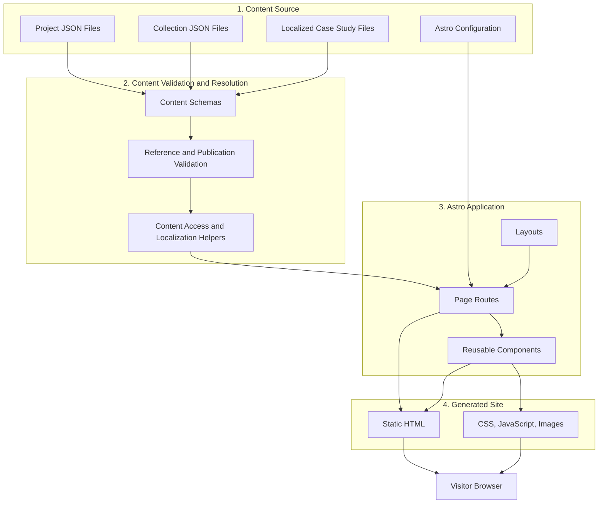
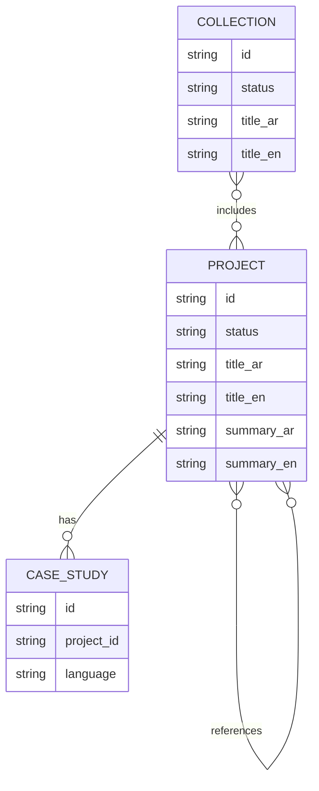

# Architecture Overview — My Portfolio

## 1. Purpose

This document describes the intended software architecture of My Portfolio, a bilingual developer portfolio built with Astro.

It defines the main architectural components, their responsibilities, content flow, rendering strategy, and key design constraints.

The architecture is intended to support:

- Structured project presentation.
- Arabic and English content.
- Search and filtering.
- Public collections of selected projects.
- Optional case studies and related projects.
- Evidence-based descriptions of technical work.
- Simple maintenance by a single developer.

This document describes the target architecture, not necessarily the current implementation state.

## 2. Architectural Goals

The architecture should:

1. Keep the initial system simple and suitable for a single developer.
2. Avoid unnecessary backend services and infrastructure.
3. Treat repository content files as the source of truth.
4. Validate content and references before publication.
5. Generate fast, deployable static pages.
6. Support Arabic RTL and English LTR layouts.
7. Keep project metadata separate from long-form case-study content.
8. Support curated public collections without duplicating project information.
9. Make future changes possible without premature architectural complexity.

## 3. Architectural Style

The initial system uses:

- **Static site generation (SSG):** Astro generates pages during the build process.
- **File-based content management:** Projects, collections, and case studies are maintained in the repository.
- **Component-based presentation:** Reusable Astro components render shared interface elements.
- **Schema-driven validation:** Content schemas define required fields and validate structured content.
- **Client-side interaction:** Search and filtering initially run in the browser when catalogue size and performance permit.

The system is a single Astro application. It does not require microservices, a separate API, a database, or a CMS for the current scope.

## 4. System Context

### External actors and systems

| Actor or system | Responsibility |
|---|---|
| Portfolio owner | Creates and updates content files and application code. |
| Git repository | Stores source code, structured content, case studies, and configuration. |
| Astro build process | Validates and transforms source content into a deployable site. |
| Hosting and deployment platform | Publishes the generated static site. |
| Visitor's browser | Requests pages and executes supported client-side interactions. |
| External evidence destinations | Provide repositories, demos, documentation, or other linked proof of work. |

### Context diagram

```mermaid
flowchart LR
    Owner[Portfolio Owner]
    Repo[Git Repository<br/>Code and Content]
    Build[Astro Build]
    Site[Generated Static Site]
    Host[Hosting Platform]
    Visitor[Visitor Browser]
    Evidence[External Evidence<br/>GitHub, Demos, etc.]

    Owner -->|Edits and commits| Repo
    Repo -->|Source files| Build
    Build -->|Generated HTML, CSS, JS, assets| Site
    Site -->|Deployment artifact| Host
    Visitor -->|HTTP requests| Host
    Host -->|Static responses| Visitor
    Visitor -->|Opens evidence links| Evidence
```



The hosting provider and the exact deployment workflow remain implementation decisions.

## 5. High-Level Architecture

The application can be understood as four logical areas:

1. **Content source:** Structured project and collection data, plus long-form case studies.
2. **Content validation and resolution:** Schemas, reference checks, publication eligibility, localization, and content lookup.
3. **Page generation and presentation:** Astro pages, layouts, and reusable components.
4. **Static delivery and browser interaction:** Generated assets, navigation, search, filtering, and language switching.

These are logical responsibilities within one application, not separate deployable services.

### Architecture diagram



## 6. Main Components and Responsibilities

### 6.1 Content files

**Responsibility:** Store the portfolio's authored content.

The initial content model consists of:

- **Projects:** Structured metadata such as stable ID, localized title and summary, project types, technologies, skills, role, evidence, outcomes, and related-project references.
- **Collections:** Localized title and description, a stable collection identifier, and an ordered list of project IDs.
- **Case studies:** Long-form content maintained separately by language.

Content files are the authoritative source. Derived pages should resolve their information from these files instead of maintaining duplicated copies.

### 6.2 Content schemas

**Responsibility:** Define valid content shapes.

Astro content schemas should validate the structure and data types of project, collection, and case-study content.

Typical checks include:

- Required fields and supported values.
- Stable identifiers.
- Localized fields.
- Valid dates and URLs where applicable.
- Valid project types and evidence types.
- Valid collection and related-project references.
- Constraints on published content.

Schema validation alone may not enforce every cross-file business rule. Cross-reference checks should be implemented separately when necessary.

### 6.3 Content validation and resolution

**Responsibility:** Provide safe, consistent content to page generation.

A small set of utilities should handle:

- Retrieving projects by ID.
- Resolving project IDs referenced by collections.
- Resolving related projects.
- Excluding unpublished content from public pages.
- Selecting localized interface and content values.
- Detecting missing or invalid references.
- Applying the agreed publication and translation rules.

These utilities should remain lightweight. They do not need to become a separate domain service or a complex repository framework.

### 6.4 Astro pages and routes

**Responsibility:** Define the public URLs and compose the pages.

Expected page categories include:

- Portfolio homepage.
- Project catalogue.
- Project details.
- Case studies, if implemented as separate pages.
- Public collections.
- Not-found page.

The final URL structure is not yet fixed. Route definitions should be selected after confirming the language-routing and case-study decisions.

### 6.5 Layouts and components

**Responsibility:** Render a consistent, reusable interface.

Potential components include:

- Project cards.
- Search input.
- Filter controls.
- Evidence links.
- Related-project lists.
- Language switcher.
- Collection project lists.

A shared layout should handle common metadata, navigation, global styles, language direction, and other cross-page presentation concerns.

### 6.6 Browser-side behavior

**Responsibility:** Support lightweight visitor interactions.

Initially, browser-side JavaScript may handle:

- Searching loaded projects.
- Applying selected filters.
- Updating visible results.
- Switching languages through navigation.
- Preserving or applying language preferences, if that behavior is approved.

The architecture should avoid unnecessary client-side frameworks or hydration. Astro components should render static HTML by default, adding client-side JavaScript only where interaction requires it.

## 7. Content Model and Relationships

The core conceptual relationships are:



This diagram describes conceptual relationships, not a database schema. The initial implementation uses files rather than relational tables.

### Relationship rules

- A project has a stable ID independent of its localized title.
- A project may have multiple types.
- A project may have zero or more evidence links and outcomes.
- A project may have zero or more case studies, subject to the final content and language rules.
- A collection references projects by ID.
- A project may reference other projects through manually configured related-project IDs.
- Related-project relationships are directional by default.
- A project cannot reference itself.
- Referenced content is resolved from its original source rather than copied into collections or related-project definitions.

## 8. Content and Build Flow

The main publication pipeline is:

1. The owner edits content files or application code.
2. The source changes are committed to the repository.
3. The build process loads the content.
4. Content schemas validate individual records.
5. Additional validation checks cross-file references and publication rules.
6. Astro generates the public pages and assets.
7. The generated output is deployed to the hosting platform.
8. Visitors request and receive the deployed static resources.

### Important consequence

**Content updates are build-time updates, not runtime database updates.**

A change becomes visible to visitors only after a successful build and deployment. This is intentional for the initial architecture because it reduces operational complexity.

## 9. Internationalization Architecture

The portfolio supports Arabic and English.

### Responsibilities

- Store localized project and collection fields in structured content.
- Keep long-form case studies in their respective language files.
- Centralize interface labels and translations.
- Set the document language and text direction correctly.
- Provide a language switcher.
- Resolve available content without pretending that missing translations exist.

### Direction and language

| Language | Text direction |
|---|---|
| Arabic (`ar`) | RTL |
| English (`en`) | LTR |

### Language selection

The intended initial behavior is to use browser language preferences for language-neutral public collection URLs, while allowing manual switching.

The following details remain to be finalized:

- Whether manually selected language persists across visits.
- Whether a saved manual choice takes precedence over browser preferences.
- The default language when neither Arabic nor English is preferred.
- The policy for missing translations of core project fields.
- The behavior when a case study is available in only one language.

These decisions should be centralized in the internationalization utilities rather than scattered across page components.

## 10. Public Collections and Sharing

A collection is a curated, public selection of projects.

### Design

- Each collection has a stable identifier and a public URL.
- Its content file defines membership using project IDs.
- The page resolves the current published project content during the build.
- The collection provides a path back to the full portfolio.
- No authentication or private sharing mechanism is required.

### Update behavior

Collection membership remains unchanged unless the collection definition is edited. However, project details shown within the collection are refreshed by the next successful build and deployment.

A collection should never expose unpublished projects or confidential information.

## 11. Search and Filtering

Search and filtering initially run in the visitor's browser.

### Supported dimensions

- Project type.
- Technology.
- Skill.
- Evidence type, if included in the implemented scope.

### Initial strategy

- Render the published catalogue as static content.
- Load only the data needed for the catalogue interactions.
- Apply search and filters on the client.
- Display an empty state when no results match.
- Provide a way to clear filters.

### Constraints

The browser-side approach assumes the project catalogue remains modest enough for acceptable loading and interaction performance.

If the catalogue becomes substantially larger, the implementation should be measured before considering alternatives such as pagination, partial data loading, or a search service.

## 12. Deployment and Runtime

### Build-time responsibilities

- Load content files.
- Validate content schemas.
- Validate cross-file references.
- Resolve published content and localized fields.
- Generate pages and assets.
- Fail or report errors according to the agreed validation policy.

### Runtime responsibilities

- Serve static HTML and assets.
- Execute minimal browser-side JavaScript for search and filtering.
- Support normal navigation and external evidence links.
- Display appropriate not-found pages.

### Explicitly absent from the initial design

- Application server.
- Database.
- Authentication and user accounts.
- Runtime content administration.
- Server-side search API.
- Separate backend services.
- Private collection access control.

## 13. Security and Content Integrity

Although the application has no initial backend, publication integrity still matters.

The architecture should:

- Treat all published content as public.
- Exclude confidential client information, credentials, and secrets.
- Avoid rendering arbitrary authored HTML without an explicit sanitization and trust policy.
- Validate external URLs and structured content.
- Avoid broken links caused by invalid project references.
- Prevent unpublished content from appearing in public pages or collection output.
- Keep secrets out of repository content and generated assets.

A public collection URL is not an access-control mechanism. It must not be used to protect private information.

## 14. Quality Attributes

| Attribute | Architectural approach |
|---|---|
| Performance | Static generation, optimized assets, minimal client JavaScript. |
| Maintainability | Small Astro application, explicit schemas, reusable components, file-based content. |
| Reliability | Build validation, stable IDs, reference checks, clear not-found behavior. |
| Accessibility | Semantic HTML, keyboard-accessible controls, readable layouts, appropriate language and direction attributes. |
| SEO | Static page output, meaningful metadata, stable URLs, appropriate language metadata. |
| Security | Public-data-only content, no secrets in generated output, controlled handling of authored content. |
| Portability | Static build output that can be deployed to a compatible hosting platform. |

These are design goals. Their actual achievement should be verified through implementation and testing.

## 15. Proposed Source Structure

The following structure is a starting proposal, not a commitment that every file or directory must exist.

```text
my-portfolio/
├── docs/
├── public/
│   ├── images/
│   │   └── projects/
│   ├── icons/
│   └── fonts/
├── src/
│   ├── content.config.ts
│   ├── content/
│   │   ├── projects/
│   │   ├── collections/
│   │   └── case-studies/
│   ├── components/
│   ├── layouts/
│   ├── lib/
│   │   ├── i18n.ts
│   │   ├── projects.ts
│   │   └── content-validation.ts
│   ├── pages/
│   └── styles/
├── astro.config.mjs
├── package.json
├── tsconfig.json
└── README.md
```

The exact collection names, route layout, and case-study storage conventions should be aligned with the final content schemas before implementation.

## 16. Architectural Decisions

### Confirmed decisions

- Astro is the chosen framework.
- The initial system is a single application.
- Static generation is the intended delivery model.
- Content is managed through repository files.
- The portfolio supports Arabic and English.
- Projects may belong to multiple types.
- Public collections contain manually selected project IDs.
- Collection membership is public and changes only when its definition is edited.
- Project details are refreshed after a successful rebuild and deployment.
- Related projects are configured manually and use project IDs.
- No database, CMS, or backend is required for the initial scope.

### Decisions still open

- Final route and URL structure.
- Hosting and deployment provider.
- Required language completeness for core project content.
- Language preference persistence and precedence.
- Default language.
- Case-study route and file organization.
- Exact search/filter matching semantics.
- Whether evidence-type filtering is part of the initial release.
- How strictly invalid collection references block the build.
- The minimum content required for a project to be published.

## 17. Implementation Principles

Implementation should follow these principles:

1. Start with the simplest design that satisfies the requirements.
2. Keep domain concepts separate from presentation where doing so improves clarity.
3. Do not introduce abstractions that have no current use case.
4. Prefer schema validation and small content utilities over a complex content-management layer.
5. Keep content definitions as the single source of truth.
6. Validate cross-file references before generating public pages.
7. Add client-side JavaScript only when necessary.
8. Keep architectural decisions traceable to requirements and user flows.
9. Treat unresolved decisions explicitly rather than silently assuming answers.
10. Revisit architectural complexity only when measured constraints or new requirements justify it.

## 18. Next Steps

Before implementation, the next useful artifacts are:

1. Finalize the remaining content and routing decisions.
2. Define the detailed content schemas and validation rules.
3. Update the C4 Context and Container diagrams to match the final architecture.
4. Define the initial Astro routes and their responsibilities.
5. Map functional requirements to pages, components, and validation behavior.
6. Implement a thin vertical slice: one project, one collection, one localized page, and a successful production build.
7. Add automated checks for schema validity, references, localization, and public-content eligibility.

The architecture should evolve in response to validated requirements rather than adding complexity in anticipation of hypothetical future needs.